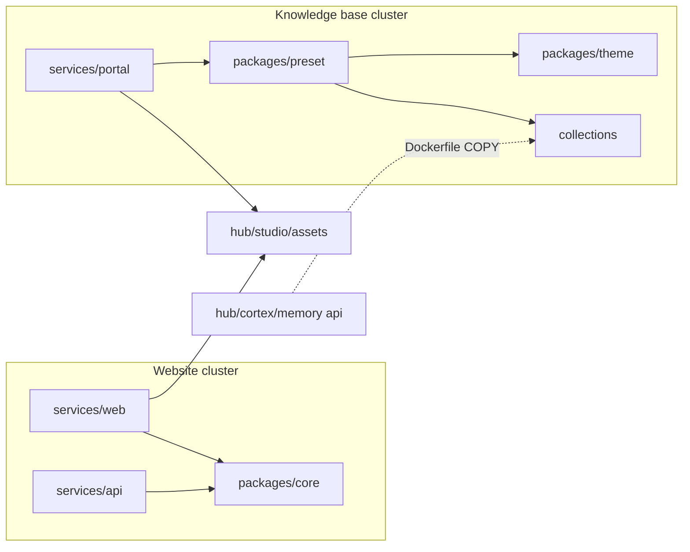

# Corporate Context Restructure

Analysis and migration plan for the `corporate` bounded context. It evaluates moving `collections`
into `packages`, flattening `namespaces` into reusable per-kind collections, extracting UI strings
from `core`, renaming `services/web` to `services/website`, and splitting `corporate` into
sub-domains. It extends the earlier [Monorepo restructure](./monorepo-restructure.md), which merged
the website and the documentation portal under one parent.

## 1. Verdict Summary

| #   | Proposal                                                           | Verdict                                                                   |
| :-- | :----------------------------------------------------------------- | :------------------------------------------------------------------------ |
| 1   | Move `corporate/collections` into `corporate/packages`             | Approve                                                                   |
| 2   | Remove `namespaces`; per-kind roots `docs`, `blogs`, `communities` | Approve with refinements (D2)                                             |
| 3   | Add a `github` root collection                                     | Reject for now; the directory is empty and untracked                      |
| 4   | Move `core/src/locales` into `collections/locales`                 | Modify: extract from `core`, destination is the website service (D3)      |
| 5   | Rename `services/web` to `services/website`                        | Approve; also fix the `hub-*` package prefix on corporate packages (D4)   |
| 6   | Split `corporate` into `knowledge-base/` and `website/` folders    | Defer; apply logical sub-domains and boundary rules now, split on trigger |
| 7   | Move `core` to `shared/` or promote it to a global package         | Reject; keep `core` inside `corporate` (D6)                               |

Recommended end state is **Option B+** (section 4): the proposals 1, 2, 4 and 5 applied, `core` kept
in `corporate/packages`, and two logical sub-domains (`website` and `kb`) enforced by boundary rules
instead of folders.

## 2. Evidence

### 2.1 Current Topology and Dependency Graph

```text
corporate/
  collections/            @monorepo/kb-collections    namespaces/{portal,github}, crowdin/
  packages/core           @monorepo/hub-core
  packages/preset         @monorepo/kb-docusaurus-preset
  packages/theme          @monorepo/kb-docusaurus-theme
  services/api            @monorepo/hub-api
  services/web            @monorepo/hub-web
  services/portal         @monorepo/kb-docusaurus-portal
```



The two clusters have **no dependency edge between them**. They share only `hub/studio/assets` and
`shared/config`. Package prefixes already encode two contexts: `hub-*` for the website cluster and
`kb-*` for the documentation cluster.

### 2.2 Findings

| ID  | Finding                                                                                                                                                                                                                                                                                                                                                                                                            | Impact                                                             |
| :-- | :----------------------------------------------------------------------------------------------------------------------------------------------------------------------------------------------------------------------------------------------------------------------------------------------------------------------------------------------------------------------------------------------------------------- | :----------------------------------------------------------------- |
| F1  | Corporate packages are named `@monorepo/hub-core`, `hub-api`, `hub-web`. Root scripts `hub:dev`, `hub:build`, `hub:lint`, `hub:typecheck` filter `@monorepo/hub-*`, so a `hub:*` command runs corporate workspaces.                                                                                                                                                                                                | Misleading names; agents route to the wrong context                |
| F2  | [corporate/AGENTS.md](../../../corporate/AGENTS.md) and [corporate/README.md](../../../corporate/README.md) list `api/`, `portal/`, `web/` as sub-domains. The real paths are `services/api`, `services/portal`, `services/web`.                                                                                                                                                                                   | Router drift                                                       |
| F3  | [portal AGENTS.md](../../../corporate/services/portal/AGENTS.md) links to `../../../collections/...` and `knowledge-base/collections/...`. Both are stale since the restructure.                                                                                                                                                                                                                                   | Broken navigation for agents                                       |
| F4  | The knowledge base pages [domain-driven-monorepo.mdx](../../../corporate/collections/namespaces/portal/content/docs/explanation/domain-driven-monorepo.mdx) and [bounded-contexts.mdx](../../../corporate/collections/namespaces/portal/content/docs/explanation/bounded-contexts.mdx) describe the pre-restructure topology: `hub` as the website, root `cortex/`, `studio/`, `platform/`, and `knowledge-base/`. | Public documentation contradicts the repository                    |
| F5  | [core index.ts](../../../corporate/packages/core/src/index.ts) re-exports `locales/pt-br.js` (48 lines of pt-BR strings). Only the website consumes `translations`. The API never imports it.                                                                                                                                                                                                                      | Presentation strings inside a contract library; shipped to the API |
| F6  | `portal.config.ts` duplicates [project.config.ts](../../../shared/config/src/project.config.ts) with one extra key.                                                                                                                                                                                                                                                                                                | Two sources of truth for project variables                         |
| F7  | `hub/cortex/memory/services/api/Dockerfile` copies `corporate/collections/namespaces/portal/content` in two stages. The coupling is invisible to pnpm and Turborepo.                                                                                                                                                                                                                                               | Hidden cross-context dependency                                    |
| F8  | The `namespaces/<ns>/content/<name>` convention is hardcoded in the preset, the locales-sync plugin, two portal tooling scripts, `docusaurus.config.ts`, `tsconfig.build.json`, `crowdin.yml`, Skaffold, and ESLint.                                                                                                                                                                                               | Every path change touches nine files                               |
| F9  | `corporate/collections/namespaces/github/templates` has zero tracked files (`git ls-files` returns 0).                                                                                                                                                                                                                                                                                                             | Local leftover; nothing to migrate                                 |
| F10 | `deploy-docs.yaml` triggers on `corporate/**`, so a website change rebuilds and redeploys the documentation portal.                                                                                                                                                                                                                                                                                                | Wasted CI minutes; avoidable with narrower path filters            |
| F11 | Terms are polysemic: "collection" (docs content versus MongoDB collection in the API), "locale" (Crowdin output versus runtime i18next strings), "web" (corporate website versus `cortex/memory/services/web`).                                                                                                                                                                                                    | Ubiquitous language violation per the Bounded Contexts principle   |

Reference counts used to size the work (`git grep -l`, excluding `pnpm-lock.yaml` and plans):

| Token                    | Files |
| :----------------------- | :---- |
| `@monorepo/hub-core`     | 51    |
| `@monorepo/hub-web`      | 8     |
| `@monorepo/hub-api`      | 8     |
| `kb-collections`         | 9     |
| `kb-docusaurus-portal`   | 11    |
| `namespaces/portal`      | 11    |
| `corporate/collections`  | 6     |
| `corporate/services/web` | 2     |

### 2.3 External Research

Gathered with Context7 and Firecrawl.

- **Docusaurus multi-instance**: a second docs or blog instance requires a unique `id`; `path` and
  `routeBasePath` are per instance. A content directory is therefore reusable by any site that
  mounts it with its own instance (docs-multi-instance, blog "Multiple blogs").
- **Docusaurus i18n**: translations live at `i18n/<locale>/docusaurus-plugin-content-<type>[-<id>]/`
  (docs add `current/`). The directory is keyed by plugin id, not by collection. `i18n.path` and
  `localeConfigs.<locale>.path` are configurable.
- **pnpm**: `packages` accepts globs and negations; the `workspace:` protocol forces local linking
  and fails instead of resolving from the registry.
- **Turborepo Boundaries**: packages receive `tags` in their `turbo.json`; the root `boundaries`
  block declares `allow` and `deny` rules per tag.
- **DDD**: a Shared Kernel must stay small and co-owned; code that changes with one domain belongs
  to that context (Martin Fowler on Bounded Context, DevIQ on Shared Kernel, and the Go monorepo
  analysis of `internal/` versus `shared/`).

Sources: [Docs multi-instance](https://docusaurus.io/docs/docs-multi-instance),
[Blog](https://docusaurus.io/docs/blog), [i18n introduction](https://docusaurus.io/docs/i18n/introduction),
[pnpm workspaces](https://pnpm.io/workspaces),
[Turborepo boundaries](https://turborepo.dev/docs/reference/boundaries),
[Bounded Context](https://martinfowler.com/bliki/BoundedContext.html),
[Shared Kernel](https://deviq.com/domain-driven-design/shared-kernel/).

## 3. Decisions

### D1. Move `collections` into `packages`

Approved. `collections` is a content package: it has a `package.json` with an `exports` map and is
resolved through `require.resolve('@monorepo/kb-collections/package.json')`. Placing it at
`corporate/packages/collections` removes the dedicated `'corporate/collections'` entry in
[pnpm-workspace.yaml](../../../pnpm-workspace.yaml) because `corporate/packages/*` covers it, and it
reduces the depth of every content file by one level. The package name stays
`@monorepo/kb-collections` to avoid touching nine files.

### D2. Flatten `namespaces` into per-kind collections

Approved with refinements. A kind-first layout makes each content type a uniform contract and lets
a future site mount any collection.

```text
corporate/packages/collections/
  docs/portal/             Diataxis quadrants and workspaces
  blogs/portal/            posts, releases, authors.yml, tags.yml
  communities/portal/      roadmap, team, contributing
  messages/portal/         Docusaurus theme and plugin strings (source language en)
  locales/pt-BR/{docs,blogs,communities,messages}/portal/   Crowdin-managed, never edited manually
  crowdin/                 styleguides, glossary, project description
```

Refinements:

1. **Kind and plugin type differ.** `communities` is consumed by a Docusaurus docs-plugin instance
   (`id: 'community'`). The preset maps `docs` and `communities` to plugin type `docs`, and `blogs`
   to `blog`. Locale targets are derived from plugin type and instance id, not from the kind.
2. **Keep `communities` separate from `docs`.** The Diataxis guardrail applies to `docs/` only;
   community pages (roadmap, team) are free-form. Separate roots allow per-kind guardrails in the
   collection router file.
3. **Add `messages`.** Today `content/messages` is synced once per namespace. After flattening it
   needs an explicit mapping (preset option `messages: 'portal'`).
4. **Locales are keyed by collection, not by plugin id.** `locales/<locale>/<kind>/<name>` keeps
   translations reusable when a second site mounts the same collection with a different plugin id.
   The existing locales-sync bridge stays; making `i18n.path` point at `locales/` directly would
   couple translations to plugin ids and is rejected.
5. **Remove `portal.config.ts` from the collection.** It belongs to a site, not to content. Import
   `@monorepo/shared-config/project.config` instead (F6).

### D3. Extract UI strings from `core`

`core/src/locales/pt-br.ts` must leave `core`: a contract library should not carry presentation
strings, and the API bundles them for no reason (F5). The destination is **not**
`collections/locales`:

| Aspect          | Docs locales (`collections/locales`)       | Website UI strings               |
| :-------------- | :----------------------------------------- | :------------------------------- |
| Source language | `en`                                       | `pt-BR`                          |
| Authoring       | Crowdin pull requests; manual edits banned | Human edits in the repository    |
| Consumer        | Docusaurus i18n bridge                     | i18next at runtime (Vite)        |
| Key contract    | Docusaurus plugin ids and message ids      | API error codes and feature keys |

Mixing them contradicts the rule "files in `locales/` are managed exclusively by Crowdin" and would
add a dependency from the website to the knowledge base cluster. Move `translations` into
[services/website/src/i18n/locales/pt-br.ts](../../../corporate/services/web/src/i18n/locales/pt-br.ts),
which already holds the `ui` namespace, and delete the export from the `core` barrel. Revisit
`collections/messages/website` only when a second UI locale is required.

### D4. Rename `services/web` to `services/website`

Approved. It removes the collision with `cortex/memory/services/web` (F11) and matches the
ubiquitous language. Package identity changes with it:

| Current              | Target                        |
| :------------------- | :---------------------------- |
| `@monorepo/hub-core` | `@monorepo/corporate-core`    |
| `@monorepo/hub-api`  | `@monorepo/corporate-api`     |
| `@monorepo/hub-web`  | `@monorepo/corporate-website` |
| `hub:*` root scripts | `corporate:*` root scripts    |

The `kb-*` packages keep their prefix: `kb` is the established name of the documentation
sub-domain and 20 root scripts depend on it. Kubernetes resource names, image names, and hostnames
(`corporate-web`, `web-dev`) are out of scope because internal URLs depend on them.

### D5. Split `corporate` into `knowledge-base/` and `website/`

Four options were compared.

| Criterion                 | A: Status quo + hygiene | B+: D1, D2, D3, D4 + logical sub-domains | C: Physical split                           | D: `core` to `shared/`, contexts to root |
| :------------------------ | :---------------------- | :--------------------------------------- | :------------------------------------------ | :--------------------------------------- |
| DDD alignment             | Low (F1, F11)           | High (rules enforce the two clusters)    | Highest (folders mirror contexts)           | Low (violates Shared Kernel guidance)    |
| Path stutter and depth    | None                    | None                                     | `corporate/website/services/website`        | Moderate                                 |
| Churn                     | None                    | One migration, four phases               | B+ churn plus a second move of 7 workspaces | Highest                                  |
| Router budget (120 lines) | At risk                 | Met with a shorter `corporate` router    | Met per sub-domain                          | Met                                      |
| Deploy boundary           | `corporate/` = cluster  | `corporate/` = cluster                   | `corporate/` = cluster                      | Breaks cluster to folder mapping         |
| Reversibility             | n/a                     | Full                                     | Mechanical `git mv`                         | Hard                                     |

Recommendation: **B+ now, C on trigger.** B+ is a no-regret step because every path it creates
moves as a unit under C later. C is deferred for three reasons:

1. The frontend service would become `corporate/website/services/website`, a repeated segment that
   invites path hallucination, which the router standard explicitly guards against.
2. `corporate/` maps one to one to the `k3d-corporate` cluster, the `corporate` namespace, the
   corporate Cloudflare tunnel, and the `/corporate` Infisical path. That mapping already holds.
3. Moving seven workspaces right after B+ doubles the churn on Skaffold, Dockerfiles, ESLint, and CI.

Triggers to execute option C:

- A second public product or frontend is added under `corporate`.
- Documentation and website have different owners or release cadence.
- The `corporate` router cannot stay within its 120-line budget.
- CI path filters cannot isolate the clusters (see Phase 5).

### D6. Keep `core` inside `corporate`

Reject moving `core` to `shared/`. Three independent reasons:

1. [shared/AGENTS.md](../../../shared/AGENTS.md) declares that `shared` MUST provide agnostic,
   generic utilities. `core` holds the `Product`, `Cycle`, `User`, and `Auth` schemas of one domain.
2. Only `services/api` and `services/website` consume it. No other context imports it.
3. A Shared Kernel stays small; code that changes with one domain belongs to that context.

### D7. Make the Cortex coupling explicit

The Cortex memory API ingests the documentation through `COPY` (F7). Declare the dependency instead:
add `"@monorepo/kb-collections": "workspace:*"` to the memory API `package.json` so pnpm and Turborepo
see the edge. The ingestion service traverses `DOCS_DIR` and derives workspace nodes from the
directory layout, so Phase 3 keeps the container layout identical with a compatibility mapping:

```dockerfile
COPY corporate/packages/collections/docs/portal ./docs/docs
COPY corporate/packages/collections/blogs/portal ./docs/blog
COPY corporate/packages/collections/communities/portal ./docs/community
COPY corporate/packages/collections/messages/portal ./docs/messages
```

### D8. Enforce the sub-domains

The Bounded Contexts principle states that boundaries are enforced programmatically. Declare two
tags and forbid cross-tag edges.

| Tag       | Workspaces                                 |
| :-------- | :----------------------------------------- |
| `website` | `core`, `api`, `website`                   |
| `kb`      | `collections`, `preset`, `theme`, `portal` |

```jsonc
// turbo.json
{
  "boundaries": {
    "tags": {
      "website": { "dependencies": { "deny": ["kb"] } },
      "kb": { "dependencies": { "deny": ["website"] } },
    },
  },
}
```

Validate `turbo boundaries` against the pinned `turbo` version in the catalog before relying on it.
The fallback is an `import-x/no-restricted-paths` zone pair in the root ESLint config, which already
loads `eslint-plugin-import-x`.

## 4. Target Topology (Option B+)

```text
corporate/
  AGENTS.md  README.md  tsconfig.json
  packages/
    collections/    @monorepo/kb-collections         docs, blogs, communities, messages, locales, crowdin
    core/           @monorepo/corporate-core
    preset/         @monorepo/kb-docusaurus-preset
    theme/          @monorepo/kb-docusaurus-theme
  services/
    api/            @monorepo/corporate-api
    website/        @monorepo/corporate-website
    portal/         @monorepo/kb-docusaurus-portal
```

`pnpm-workspace.yaml` loses the `'corporate/collections'` line. Content paths change as follows.

| Current                                                 | Target                                                  |
| :------------------------------------------------------ | :------------------------------------------------------ |
| `collections/namespaces/portal/content/docs`            | `packages/collections/docs/portal`                      |
| `collections/namespaces/portal/content/blog`            | `packages/collections/blogs/portal`                     |
| `collections/namespaces/portal/content/community`       | `packages/collections/communities/portal`               |
| `collections/namespaces/portal/content/messages`        | `packages/collections/messages/portal`                  |
| `collections/namespaces/portal/locales/pt-BR/docs`      | `packages/collections/locales/pt-BR/docs/portal`        |
| `collections/namespaces/portal/locales/pt-BR/blog`      | `packages/collections/locales/pt-BR/blogs/portal`       |
| `collections/namespaces/portal/locales/pt-BR/community` | `packages/collections/locales/pt-BR/communities/portal` |
| `collections/namespaces/portal/locales/pt-BR/messages`  | `packages/collections/locales/pt-BR/messages/portal`    |
| `collections/crowdin`                                   | `packages/collections/crowdin`                          |
| `collections/namespaces/portal/portal.config.ts`        | removed; use `@monorepo/shared-config/project.config`   |
| `collections/namespaces/github`                         | removed (empty, untracked)                              |

`collections` exports map:

```json
{
  "exports": {
    "./docs/*": "./docs/*",
    "./blogs/*": "./blogs/*",
    "./communities/*": "./communities/*",
    "./messages/*": "./messages/*",
    "./locales/*": "./locales/*",
    "./package.json": "./package.json"
  }
}
```

## 5. Migration Phases

Run on a dedicated branch. Use `git mv` for every move and one commit group per phase.

### Phase 0. Baseline

1. Merge or close every open `chore(l10n)` pull request. Crowdin matches source files by path; a
   move registers as delete plus add. Before the first sync after Phase 3, move the files to their
   new paths in the Crowdin project or apply translation-memory pre-translation after upload.
2. Record a green baseline: `pnpm install --frozen-lockfile`, `pnpm typecheck`, `pnpm lint`, the
   portal build for `en` and `pt-BR`, and `skaffold diagnose -f k8s/skaffold.corporate.yaml`.

### Phase 1. Package identity (no moves)

1. Rename the three `hub-*` packages to `corporate-*` (D4 table) in `package.json`, imports (51, 8,
   and 8 files), `tsconfig` paths, `vite.config.ts` `exclude`, Dockerfile comments, and README
   tables, including the renderer README template.
2. Rename root scripts `hub:*` to `corporate:*` and update the filter to `@monorepo/corporate-*`.
3. Gate: `pnpm install`, `pnpm typecheck`, `pnpm build`.

### Phase 2. Folder rename `services/web` to `services/website`

1. `git mv corporate/services/web corporate/services/website`.
2. Update the Dockerfile `WORKDIR` and `COPY --from` paths, `corporate/tsconfig.json`, and the
   Skaffold `dockerfile` and `sync.manual` paths. Keep the image name `corporate-web`.
3. Update the ESLint glob `**/services/web/**` to `**/services/website/**`; the `**/web/**` glob no
   longer matches the corporate website.
4. Gate: website build, `skaffold diagnose`.

### Phase 3. Collections restructure

1. `git mv corporate/collections corporate/packages/collections`, then flatten per the section 4
   table. Delete `namespaces/github` locally.
2. Preset ([index.ts](../../../corporate/packages/preset/src/index.ts)): replace the namespace
   resolution with kind-first resolution.

   ```ts
   const [kind, name] = opt.collection.split('/'); // for example 'docs/portal'
   opt.path = path.join(collectionsRoot, kind, name);
   mappings.push({ pluginType, pluginId, kind, name });
   ```

3. Locales sync ([plugin](../../../corporate/packages/preset/src/plugins/locales-sync/index.ts)):
   read `locales/<locale>/<kind>/<name>`; derive the target folder from plugin type and instance id;
   sync `locales/<locale>/messages/<messages option>` once into `i18n/<locale>`.
4. `docusaurus.config.ts`: `collection: 'docs/portal'`, `'communities/portal'`, `'blogs/portal'`,
   add `messages: 'portal'`, and import project variables from `@monorepo/shared-config`.
5. Update `tsconfig.build.json`, `generate-changelog.ts`, and `generate-roadmap.ts` paths
   (`blogs/portal/releases`, `communities/portal/roadmap`).
6. Update [crowdin.yml](../../../crowdin.yml) with one entry per kind:

   ```yaml
   files:
     - source: /corporate/packages/collections/docs/**/*.mdx
       translation: /corporate/packages/collections/locales/%locale%/docs/**/%original_file_name%
     - source: /corporate/packages/collections/blogs/**/*.mdx
       translation: /corporate/packages/collections/locales/%locale%/blogs/**/%original_file_name%
     - source: /corporate/packages/collections/communities/**/*.mdx
       translation: /corporate/packages/collections/locales/%locale%/communities/**/%original_file_name%
     - source: /corporate/packages/collections/messages/**/*.json
       translation: /corporate/packages/collections/locales/%locale%/messages/**/%original_file_name%
       type: chrome
   ```

7. Update `pnpm-workspace.yaml`, [eslint.config.ts](../../../eslint.config.ts) (resolver `project`
   entry and the `corporate/collections/**` ignores), `k8s/skaffold.corporate.yaml` sync paths, the
   Cortex Dockerfile (D7), and the project-variable token rule in the root `AGENTS.md`.
8. Gate: portal build for `en` and `pt-BR`, `pnpm kb:typecheck`, `skaffold diagnose`, Cortex API
   image build, and a `syncDocs` run confirming the same processed file count as the baseline.

### Phase 4. Extract UI strings from `core`

1. Merge `translations` into the website i18n resource and remove `export * from './locales/pt-br.js'`
   from the `core` barrel; delete `core/src/locales`.
2. Gate: API build is unchanged; website typecheck and build pass; login and register screens render
   the same strings.

### Phase 5. Boundaries, routers, and CI

1. Add the D8 tags and rules; run `turbo boundaries` or the ESLint fallback.
2. Narrow `deploy-docs.yaml` path filters from `corporate/**` to
   `corporate/packages/{collections,preset,theme}/**` and `corporate/services/portal/**` (F10).
3. Rewrite [corporate/AGENTS.md](../../../corporate/AGENTS.md) and its README to the real paths,
   the two logical sub-domains, and the dependency rule, within the 120-line router budget. Update
   the `AGENTS.md` of `collections` with one guardrail block per kind and fix the stale links in the
   portal router (F2, F3). Activate `agent-router-expert` and `markdown-expert` for these edits.
4. Correct the two knowledge base pages (F4) with the `docusaurus-expert` skill. Do not edit the
   `pt-BR` copies; Crowdin regenerates them.
5. Gate: `git grep` returns no match for `namespaces/portal`, `corporate/collections`,
   `@monorepo/hub-`, or `corporate/services/web`; `pnpm format:check` passes.

## 6. Risks and Mitigations

| Risk                                                                         | Mitigation                                                                  |
| :--------------------------------------------------------------------------- | :-------------------------------------------------------------------------- |
| Crowdin loses file-level progress on moved sources                           | Phase 0 item 1; translation memory preserves segments                       |
| Cortex ingestion changes node layout                                         | Compatibility `COPY` mapping in D7 and the `syncDocs` count gate            |
| Lockfile churn from package renames                                          | Regenerate with `pnpm install`; commit the lockfile with Phase 1            |
| Hidden references in MDX or JSON content                                     | Final `git grep` gate in Phase 5; portal build with `onBrokenLinks` checked |
| Stale names in the ingestion `knownWorkspaces` list (`handbook`, `platform`) | Out of scope; track in the Cortex plan                                      |

## 7. Approvals Required

| Decision                                 | Recommended default                                                   |
| :--------------------------------------- | :-------------------------------------------------------------------- |
| Keep `communities` as a separate kind    | Yes (D2.2)                                                            |
| Defer the `github` collection            | Yes; ownership belongs to the consumer (`tools/github` or `.github/`) |
| UI strings destination                   | Website service now; `collections/messages/website` later             |
| Keep Kubernetes resource and image names | Yes; rename only source paths                                         |
| Physical split of `corporate`            | Defer until a D5 trigger occurs                                       |
