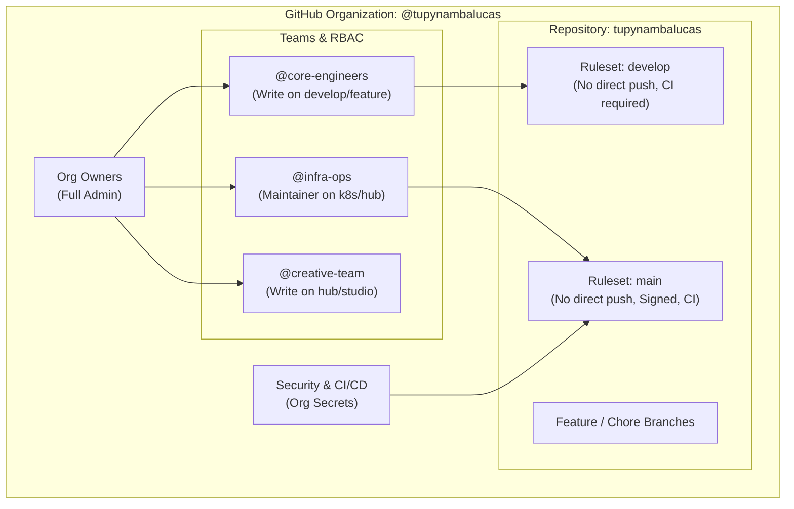

# GitHub Governance, Unified Authentication, and WSL2 Storage Architecture

This document establishes the enterprise standards for GitHub organization governance,
professional Git and GitHub CLI (`gh`) authentication across Windows and WSL2, and the storage
architecture for hosting the `tupynambalucas` monorepo inside native Linux storage.

---

## 1. Storage Architecture: Native Linux ext4 vs. Windows NTFS Mount

A fundamental architectural decision in WSL2 environments is where the source repository resides.

### Comparative Analysis

| Evaluation Criterion    | Windows NTFS Mount (`/mnt/c/...`)                | Native Linux ext4 (`~/projects/...`)           |
| :---------------------- | :----------------------------------------------- | :--------------------------------------------- |
| **I/O Performance**     | Degraded (5x-10x slower via 9P protocol)         | Bare-metal NVMe speed inside VHDX              |
| **Inotify & Watchers**  | Broken/unreliable events; high CPU polling       | Native Linux inotify (Skaffold, Vite, Fastify) |
| **Package Management**  | `pnpm` symlinks fail or degrade on NTFS          | Native POSIX hardlinks/symlinks supported      |
| **Docker & k3d Mounts** | Path mapping issues, I/O lockups, volume bugs    | Zero-overhead native Docker Engine bind mounts |
| **POSIX Permissions**   | Artificial UID/GID emulation, execution bit lost | Native Linux permissions (`chmod`, `chown`)    |

### Mandatory Decision

The repository **MUST be cloned permanently into native Linux ext4 storage** at:
`/home/tupy/projects/tupynambalucas`

Mounting the Windows NTFS directory (`/mnt/c/Users/tupyn/projects/tupynambalucas`) into WSL2 for
development is **strictly prohibited**. The existing Windows directory must be retained solely as an
offline cold backup or archived.

### Host Access to WSL2 Files (Creative Assets & Design)

For Windows host applications (Adobe Illustrator, Photoshop, Blender, and Windows Explorer) that
interact with creative assets located at `hub/studio/assets/` and `hub/studio/creative/`:

1. **Direct UNC Network Path**:
   Access files via the Windows 11 WSL network path:
   `\\wsl.localhost\tupynambalucasdev-ubuntu\home\tupy\projects\tupynambalucas`

2. **Persistent Network Drive Mapping (Optional)**:
   Map the UNC path to a designated Windows drive letter (e.g., `Z:`):

   ```powershell
   New-PSDrive -Name "Z" -PSProvider "FileSystem" -Root "\\wsl.localhost\tupynambalucasdev-ubuntu\home\tupy\projects\tupynambalucas" -Persist
   ```

   Adobe Illustrator and creative suites can open, edit, and save `.ai`, `.psd`, and `.svg` files
   directly on `Z:\hub\studio\creative\` with real-time Linux filesystem synchronization.

3. **VS Code Remote Execution**:
   VS Code uses the Remote - WSL extension. The UI process runs on Windows, while the language
   servers, linters, TypeScript compiler, and terminals execute natively inside Ubuntu with zero I/O
   translation penalty.

---

## 2. GitHub Organization Governance Architecture

Migrating the repository to a dedicated GitHub organization provides enterprise-grade access control,
isolation of organizational secrets, and team-based role delegation.



### Base Permissions and Team RBAC

1. **Base Permissions**:
   Configure organization base permissions to **No permissions** (or **Read** only). Repository
   access must be explicitly granted via Teams.

2. **Functional Teams**:
   - `@core-engineers`: Read and Write permissions on the monorepo.
   - `@infra-ops`: Maintain permissions for infrastructure, deployments, and GitHub Actions.
   - `@creative-team`: Focused access on branding, design assets, and studio workspaces.

### Repository Rulesets and Push Protection

Establish strict Repository Rulesets on the monorepo:

1. **Production Branch (`main`)**:
   - Require Pull Request before merging with at least 1 approving review.
   - Require Status Checks to pass: CI unit tests, linter, TypeScript check, and Kustomize build.
   - Require linear Git history (ban merge commits on production; rebase or squash via PR).
   - Require signed commits (SSH or GPG).
   - Prohibit branch deletion and force pushes (`git push --force` blocked).

2. **Integration Branch (`develop`)**:
   - Require Pull Request before merging with passing automated CI checks.
   - Prohibit branch deletion and direct force pushes without bypass permissions.

3. **Push Rulesets (Pre-receive Security)**:
   - Block commits containing raw `.env` or credential files.
   - Block binary files exceeding 50 MB to prevent Git repository bloat (direct large assets to Git LFS).
   - Enforce commit message formatting matching Conventional Commits syntax (`^(feat|fix|docs|style|refactor|perf|test|build|ci|chore|revert)(\([a-z0-9\-]+\))?: .{1,100}`).

> [!NOTE]
> On the GitHub Free plan for Organizations, Rulesets are applied at the repository level (`Settings -> Rules -> Rulesets`) for private repositories, or at the organization level for public repositories. Both methods provide full enforcement of required reviews, status checks, linear history, and commit signing without requiring paid seats. Upon joining the _GitHub for Startups_ program, organization-wide ruleset cascading becomes active.

### Secrets Hierarchy

Organize GitHub Secrets across three levels:

- **Organization Secrets**: Reusable tokens shared across repos (e.g., global Cloudflare tokens,
  container registry credentials). Restricted to specified repositories.
- **Repository Secrets**: Monorepo-specific build secrets.
- **Environment Secrets**: Segregated secrets bound to specific deployment environments (`dev`,
  `staging`, `prod`), with optional review protection gates for `prod`.

---

## 3. Professional Git & GitHub CLI Authentication Architecture

To ensure security, operational freedom, and cryptographic integrity across Windows and WSL2, the
architecture implements three distinct, complementary security layers that operate simultaneously
without collision:

| Security Layer                      | Technology                       | Primary Domain            | Purpose & Scope                                                                                |
| :---------------------------------- | :------------------------------- | :------------------------ | :--------------------------------------------------------------------------------------------- |
| **Layer 1: Platform & API**         | **GitHub CLI (`gh`)**            | GitHub REST / GraphQL API | Manages issues, PRs, org settings, secrets, and workflows via OAuth tokens.                    |
| **Layer 2: Transport & Sync**       | **Git Credential Manager (GCM)** | Git over HTTPS            | Authenticates code transport (`push`, `pull`, `clone`) sharing Windows Vault with WSL2.        |
| **Layer 3: Cryptographic Identity** | **SSH Commit Signing**           | OpenSSH (`ed25519`)       | Signs commit hashes to guarantee immutable authorship and yield the GitHub **Verified** badge. |

### Windows Authentication Setup

1. **GitHub CLI (`gh`) Authentication**:
   Authenticate using OAuth web flow with an amplified scope set that strictly omits `delete_repo`:

   ```powershell
   gh auth login -h github.com -p https -w -s repo,admin:org,workflow,write:packages,admin:public_key,project,gist
   ```

2. **Git Credential Helper Binding**:
   Register the credential helper so native Windows Git uses the `gh` authenticated session:

   ```powershell
   gh auth setup-git
   ```

3. **Verify Auth Status**:
   ```powershell
   gh auth status
   ```

### WSL2 Cross-Platform Credential Sharing

Rather than maintaining separate, uncoordinated tokens inside Ubuntu, configure the Linux Git engine
to delegate authentication directly to the Windows Git Credential Manager binary.

Execute inside `tupynambalucasdev-ubuntu`:

```bash
# Configure Linux Git to use the Windows Git Credential Manager
git config --global credential.helper "/mnt/c/Program\\ Files/Git/mingw64/bin/git-credential-manager.exe"

# Configure standard user metadata
git config --global user.name "Lucas Tupynamba"
git config --global user.email "contato@tupynambalucas.dev"
```

This configuration ensures:

- Token refresh in Windows automatically updates authentication in Linux.
- Zero credentials stored in cleartext inside the WSL filesystem.
- Git operations (`git pull`, `git push`, `git clone`) execute without password prompts.

### Commit Signing via SSH (Verified Badge)

Modern GitHub engineering standards favor SSH commit signing over GPG due to simplicity and
reliability across Windows and Linux.

1. **Generate SSH Key inside WSL2**:

   ```bash
   ssh-keygen -t ed25519 -C "contato@tupynambalucas.dev" -f ~/.ssh/id_ed25519 -N ""
   ```

2. **Upload Public Key to GitHub**:
   Use the authenticated GitHub CLI to register the key as a signing key:

   ```bash
   gh ssh-key add ~/.ssh/id_ed25519.pub --title "WSL2 Tupynamba Dev Key" --type signing
   ```

3. **Configure Git for Automatic SSH Signing**:
   ```bash
   git config --global gpg.format ssh
   git config --global user.signingkey ~/.ssh/id_ed25519.pub
   git config --global commit.gpgsign true
   ```

All commits authored in the repository will display the green **Verified** badge on GitHub.

---

## 4. Monorepo Transfer Runbook

When transferring the monorepo from the personal profile (`tupynambalucas/tupynambalucas`) to the
organization (`<org-name>/tupynambalucas`):

1. **Prerequisite**: Ensure the personal account is an **Owner** of the target organization.
2. **Execute Transfer via GitHub CLI**:
   ```powershell
   gh api -X POST /repos/tupynambalucas/tupynambalucas/transfer -f new_owner=<org-name>
   ```
3. **Update Local Git Remotes**:
   Inside both Windows and WSL2 clones:
   ```bash
   git remote set-url origin https://github.com/<org-name>/tupynambalucas.git
   git remote -v
   ```
4. **GitHub Automatic Redirects**:
   GitHub automatically establishes HTTP and Git redirects from the legacy namespace to the new
   organizational URL, preventing breaks for existing CI/CD webhooks and clones.

---

## 5. Implementation Checklist

- [ ] Execute `gh auth login` on Windows with recommended scopes (no `delete_repo`).
- [ ] Bind Git Credential Manager to WSL2 via `/mnt/c/Program\ Files/Git/mingw64/bin/git-credential-manager.exe`.
- [ ] Generate ED25519 SSH key inside WSL2 and enable SSH commit signing (`commit.gpgsign true`).
- [ ] Clone repository into `/home/tupy/projects/tupynambalucas` inside WSL2 ext4.
- [ ] Transfer repository to GitHub organization and update remote URLs.
- [ ] Configure organization base permissions and repository rulesets for `main` and `develop`.
