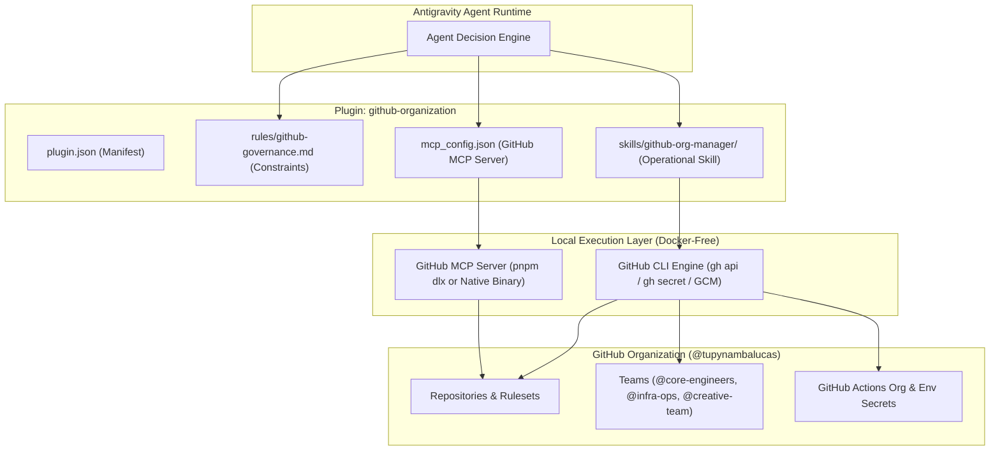
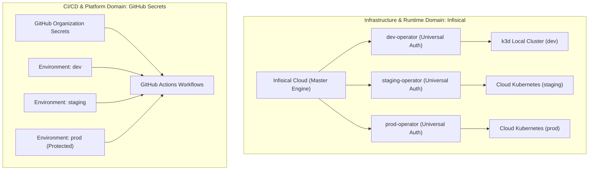
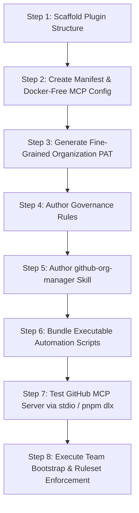

# GitHub Organization Plugin Architectural Plan

This document establishes the architecture, specification, and implementation plan for the
`github-organization` plugin located at `.agents/plugins/github-organization/`. It defines how the
GitHub MCP server couples with a specialized administrative Agent Skill (`github-org-manager`) to
enforce enterprise governance across GitHub organizations, repositories, teams, rulesets, and
secrets without Docker, adhering to the [GitHub Governance & Storage Plan](./github-governance-and-storage.md)
and the [Secrets Management Architecture Plan](./secrets-management.md).

---

## 1. Executive Summary & Problem Statement

Managing enterprise GitHub assets requires two distinct operational modalities:

1. **Transactional Tool Operations**: Real-time reading of code, querying issues, opening pull
   requests, reading commit trees, and triggering CI workflows through standard MCP tool invocations.
2. **Administrative Organization Orchestration**: Creating functional teams, managing team
   memberships, binding repository RBAC roles, establishing branch protection rulesets, and syncing
   organizational secrets.

### Architectural Gap in Upstream GitHub MCP Servers

Inspection of upstream Model Context Protocol implementations reveals a fundamental divide:

| Governance Domain                   | Official GitHub MCP Server Support                  | Gap Resolution Strategy                                   |
| :---------------------------------- | :-------------------------------------------------- | :-------------------------------------------------------- |
| **Repository Operations**           | Supported (`repos` toolset)                         | Native MCP tool calls                                     |
| **Rulesets & Policies**             | Supported (`governance` toolset)                    | Native `create_repository_ruleset` MCP tool               |
| **Custom Properties**               | Supported (`governance` toolset)                    | Native `custom_properties_write` MCP tool                 |
| **Team Membership Queries**         | Supported read-only (`context` toolset)             | Native `get_teams`, `get_team_members` MCP tools          |
| **Team Creation & Lifecycle**       | Not Supported (no `team_create` tool)               | `github-org-manager` skill via `gh api /orgs/{org}/teams` |
| **Team Member Assignment**          | Not Supported (no `team_membership_write` tool)     | `github-org-manager` skill via `gh api` membership PUT    |
| **Team Repository RBAC**            | Not Supported (no `team_repo_permission` tool)      | `github-org-manager` skill via `gh api` permissions PUT   |
| **Organization & Repo Secrets**     | Not Supported (secret scanning only, no write tool) | `github-org-manager` skill via `gh secret set` CLI        |
| **Base Permissions & Org Settings** | Not Supported                                       | `github-org-manager` skill via `gh api /orgs/{org}`       |

### Dual-Engine Design

To provide 100% operational autonomy without Docker daemon dependencies, the `github-organization`
plugin implements a **dual-engine architecture**:



1. **GitHub MCP Server Engine**: Provides high-frequency repository, PR, issue, branch, and ruleset
   tools directly to the LLM context via standard stdio communication.
2. **`github-org-manager` Skill Engine**: Provides procedural runbooks and deterministic shell
   scripts utilizing `gh api` and `gh secret` for administrative lifecycle mutations that fall
   outside the MCP server schema.

---

## 2. Docker-Free Runtime Execution Analysis

The official upstream GitHub MCP Server (`github/github-mcp-server`) is authored in Go. GitHub does
not publish an official package to the npm registry. However, containerization via Docker is not
mandatory for running MCP servers.

### Comparative Runtime Evaluation

| Execution Method                     | Runtime Mechanism                           | Pros                                                 | Cons                                                   |
| :----------------------------------- | :------------------------------------------ | :--------------------------------------------------- | :----------------------------------------------------- |
| **Approach 1: Native Go Binary**     | Prebuilt binary (`github-mcp-server stdio`) | Bare-metal speed (<10ms boot), zero node/docker deps | Requires binary download per OS (Win/Linux)            |
| **Approach 2: `pnpm dlx` (Node.js)** | TypeScript MCP server (e.g., Octokit-based) | Unified with `pnpm dlx` stack, zero system install   | Community maintained; slight cold start delay (~800ms) |
| **Approach 3: Local Monorepo Tool**  | Internal runner script in `tools/`          | Complete deterministic control over dependencies     | Requires maintaining internal entrypoint               |

### Authoritative Runtime Standard

The architecture establishes **Approach 1 (Native Go Binary via stdio)** as the primary production
engine for performance and official protocol compliance, with **Approach 2 (`pnpm dlx`)**
supported as a zero-setup alternative for pure Node.js environments.

#### Approach 1: Native Binary Configuration (`mcp_config.json`)

Prebuilt binaries are distributed via GitHub Releases for Windows (`github-mcp-server_Windows_x86_64.zip`)
and Linux ext4 (`github-mcp-server_Linux_x86_64.tar.gz`). Placing the binary in PATH or a shared
`tools/bin/` directory yields the cleanest zero-overhead configuration:

```json
{
  "mcpServers": {
    "github": {
      "command": "github-mcp-server",
      "args": ["stdio"],
      "env": {
        "GITHUB_PERSONAL_ACCESS_TOKEN": "${env:GITHUB_PAT}",
        "GITHUB_TOOLSETS": "context,repos,issues,pull_requests,actions,governance,secret_protection,security_advisories,projects"
      }
    }
  }
}
```

#### Approach 2: Node.js Execution via `pnpm dlx` (`mcp_config.json`)

When running strictly via Node.js package managers without pre-installing system binaries, the
runtime executes a TypeScript-based GitHub MCP server (`github-mcp-server-js` or `@open-work-org/github-mcp-server`):

```json
{
  "mcpServers": {
    "github": {
      "command": "pnpm",
      "args": ["dlx", "github-mcp-server-js"],
      "env": {
        "GITHUB_PERSONAL_ACCESS_TOKEN": "${env:GITHUB_PAT}"
      }
    }
  }
}
```

---

## 3. Fine-Grained Personal Access Token (PAT) Specification

Rather than relying on classic PATs with broad, account-wide scopes (`repo`, `admin:org`), the
organization standardizes on **Organization-Scoped Fine-Grained Personal Access Tokens**.

### Prerequisites & Organization Policies

Before generating a fine-grained PAT for automation, the organization owner must enable access:

1. Navigate to: `GitHub Organization Settings -> Personal access tokens -> Settings`.
2. Select: **Allow access via fine-grained personal access tokens**.
3. Policy Selection: Choose **Do not require administrator approval** (for rapid bootstrapping) or
   **Require administrator approval** (for strict multi-operator security).
4. Resource Owner: When generating the token, set the **Resource Owner** explicitly to the
   organization (`tupynambalucas`).
5. Repository Selection: Select **Only select repositories** -> `tupynambalucas/tupynambalucas` (or
   **All repositories** for organization-wide tooling).

### Required Fine-Grained Permission Matrix

To satisfy both the GitHub MCP server tools and the `github-org-manager` administrative skill,
the fine-grained PAT requires the following explicit permissions:

#### A. Repository Permissions (Target: `tupynambalucas/tupynambalucas`)

| Permission Name       | Access Level   | Justification & Operational Scope                           |
| :-------------------- | :------------- | :---------------------------------------------------------- |
| **Administration**    | `Read & Write` | Manage repository branch rulesets and team access bindings  |
| **Metadata**          | `Read-only`    | Mandatory baseline requirement for all GitHub REST queries  |
| **Contents**          | `Read & Write` | Commit code, manage branches, read file blobs and Git trees |
| **Pull Requests**     | `Read & Write` | Open, review, update, and merge pull requests               |
| **Issues**            | `Read & Write` | Create, triage, update issues, sub-issues, and labels       |
| **Actions**           | `Read & Write` | Inspect CI workflow runs, cancel/trigger jobs, fetch logs   |
| **Secrets**           | `Read & Write` | Inject and rotate repository-level build secrets            |
| **Custom Properties** | `Read & Write` | Read and apply governance metadata on repositories          |
| **Security Events**   | `Read-only`    | Inspect Dependabot and CodeQL security alerts               |

#### B. Organization Permissions (Target: Organization `@tupynambalucas`)

| Permission Name    | Access Level   | Justification & Operational Scope                          |
| :----------------- | :------------- | :--------------------------------------------------------- |
| **Members**        | `Read & Write` | Required for `POST /orgs/{org}/teams` and managing members |
| **Secrets**        | `Read & Write` | Manage organization-level shared secrets for Actions       |
| **Administration** | `Read-only`    | Read organization baseline settings and audit profiles     |

> [!IMPORTANT]
> Fine-grained PATs do not support the dangerous `delete_repo` permission by default, providing
> an inherent cryptographic guardrail against accidental repository deletion that classic PATs
> lacked.

---

## 4. Architectural Domain Partition: Infisical vs. GitHub Secrets

The separation of secrets across two specialized systems represents the industry gold standard for
enterprise platforms.



### Comparative Domain Evaluation

| Evaluation Factor                   | Storing All Secrets in GitHub                      | Storing All Secrets in Infisical                    | Domain Partitioning (Recommended)                          |
| :---------------------------------- | :------------------------------------------------- | :-------------------------------------------------- | :--------------------------------------------------------- |
| **Kubernetes Runtime Access**       | Poor (Requires complex sync pipelines into etcd)   | Excellent (Native Infisical Kubernetes Operator)    | **Optimal** (Infisical manages cluster CRDs directly)      |
| **CI/CD Build Pipeline Speed**      | Instant (<5ms zero-latency injection in runner)    | Dependent on external API token exchange per step   | **Optimal** (GitHub Actions reads native secrets)          |
| **Failure Cascades & Availability** | If GitHub is down, clusters cannot restart secrets | If Infisical is down, CI/CD pipelines fail entirely | **Resilient** (Cluster and CI domains fail-isolated)       |
| **Blast Radius Isolation**          | CI compromise leaks database master passwords      | Kubernetes node compromise leaks CI deploy keys     | **Strict Boundary** (Zero cross-domain credential leakage) |
| **Environment Approval Gates**      | Native (GitHub Environment Protection Reviewers)   | Requires custom enterprise Infisical approval flows | **Optimal** (GitHub protects production deployments)       |

### Formal Boundary Definition

1. **Infisical Domain (Cluster Runtime & Infrastructure)**:
   - **Scope**: All workloads executing inside Kubernetes (`k3d-hub`, `k3d-corporate`, cloud clusters).
   - **Secrets Stored**: MongoDB root credentials, Redis auth tokens, Fastify JWT private keys,
     Cloudflared tunnel service credentials, and internal microservice tokens.
   - **Access Vector**: Kubernetes `InfisicalSecret` Custom Resources bound to scoped Machine
     Identities (`k3d-dev-operator`, `cloud-staging-operator`, `cloud-prod-operator`).

2. **GitHub Secrets Domain (CI/CD Pipelines & Platform Integration)**:
   - **Scope**: Ephemeral GitHub Actions runners and GitHub platform integrations.
   - **Secrets Stored**:
     - _Organization Secrets_: Container registry tokens (`GHCR_TOKEN`, `DOCKERHUB_TOKEN`) and
       cross-repo notification webhooks.
     - _Environment Secrets_: Cloudflare Pages deployment tokens (`CLOUDFLARE_PAGES_TOKEN`),
       code coverage upload tokens (`CODECOV_TOKEN`), and release signing keys.
   - **Access Vector**: Directly referenced within GitHub Actions workflow definitions
     (`${{ secrets.VAR_NAME }}`).

---

## 5. Plugin Architecture & Directory Layout

Adhering strictly to the [plugin-expert standard](../../skills/plugin-expert/SKILL.md) and
[skill-expert standard](../../skills/skill-expert/SKILL.md), the plugin is scaffolded as follows:

```plaintext
.agents/plugins/github-organization/
├── plugin.json
├── mcp_config.json
├── rules/
│   └── github-governance.md
└── skills/
    └── github-org-manager/
        ├── SKILL.md
        ├── scripts/
        │   ├── bootstrap-teams.sh
        │   ├── sync-team-permissions.sh
        │   └── configure-rulesets.sh
        └── references/
            ├── rbac-matrix.md
            └── ruleset-schemas.md
```

---

## 6. Component Specifications

### A. Plugin Manifest (`plugin.json`)

The manifest identifies the plugin to the Antigravity runtime:

```json
{
  "$schema": "https://antigravity.google/schemas/v1/plugin.json",
  "name": "github-organization",
  "description": "Enterprise GitHub organization governance plugin combining the GitHub MCP server with organizational management skills, fine-grained PAT authentication, and rules."
}
```

### B. MCP Server Configuration (`mcp_config.json`)

Configured for native binary stdio or `pnpm dlx` execution without Docker:

```json
{
  "mcpServers": {
    "github": {
      "command": "github-mcp-server",
      "args": ["stdio"],
      "env": {
        "GITHUB_PERSONAL_ACCESS_TOKEN": "${env:GITHUB_PAT}",
        "GITHUB_TOOLSETS": "context,repos,issues,pull_requests,actions,governance,secret_protection,security_advisories,projects"
      }
    }
  }
}
```

### C. Governance Rules (`rules/github-governance.md`)

```markdown
# GitHub Organization Governance Rules

These rules govern all automated GitHub operations within the organization.

## 1. Branch Safety & Push Policies

- DIRECT PUSH PROHIBITED: Agents MUST NEVER push code directly to the `main` or `develop` branches.
- DEDICATED BRANCHES: All modifications must be committed to dedicated branches named with
  conventional prefixes (`feat/`, `fix/`, `chore/`, `refactor/`, `docs/`).
- LINEAR HISTORY: Merge commits are prohibited on `main`. Pull requests must be merged using Squash
  and Merge or Rebase and Merge.

## 2. Commit Cryptography & Verification

- COMMIT SIGNING: Every commit authored by automated tooling or human operators must be
  cryptographically signed using SSH (`commit.gpgsign true`). Unsigned commits will be rejected by
  repository rulesets.
- CONVENTIONAL COMMITS: Commit messages must adhere to Conventional Commits syntax:
  `^(feat|fix|docs|style|refactor|perf|test|build|ci|chore|revert)(\([a-z0-9\-]+\))?: .{1,100}`.

## 3. Secret Protection & Pre-receive Auditing

- ZERO CREDENTIAL COMMIT: Committing `.env` files, private keys, or raw API tokens is strictly
  blocked by push protection.
- SECRET PARTITIONING: Cluster secrets reside strictly in Infisical. CI/CD pipeline secrets reside
  strictly in GitHub Secrets. Never bridge cluster database secrets into GitHub Actions environments.

## 4. Role-Based Access Control (RBAC) Boundaries

- BASE PERMISSIONS: Organization repository base permissions must be set to `none` or `read`.
- TEAM DELEGATION: All repository access must be granted strictly through functional teams:
  - `@tupynambalucas/core-engineers`: Write access to monorepo application packages.
  - `@tupynambalucas/infra-ops`: Maintain access to infrastructure, workflows, and deployment overlays.
  - `@tupynambalucas/creative-team`: Write access scoped to `hub/studio/assets` and creative assets.
```

---

## 7. Operational Skill Specification (`github-org-manager`)

### A. Skill Frontmatter & Core Instructions (`SKILL.md`)

```markdown
---
name: github-org-manager
description: Use this skill to manage GitHub organization teams, assign repository RBAC permissions, configure branch protection rulesets, and manage GitHub Actions secrets using the GitHub CLI (gh) and the GitHub MCP server.
---

# GitHub Organization Manager

This skill establishes administrative workflows for bootstrapping and managing the GitHub
organization, functional teams, repository rulesets, and GitHub Actions pipeline secrets.

## 1. Prerequisites & Authentication

Ensure the active shell is authenticated using an organization-scoped Fine-Grained Personal Access
Token or an authenticated GitHub CLI session:

\`\`\`bash
gh auth status
\`\`\`

If scopes are missing, authenticate with required administrative scopes:

\`\`\`bash
gh auth login -h github.com -p https -w -s repo,admin:org,workflow,write:packages,admin:public_key,project,gist
\`\`\`

## 2. Team Lifecycle Management

The organization requires three functional teams:

1. `@core-engineers`: Core software engineers with code authoring permissions.
2. `@infra-ops`: Platform and DevOps engineers managing clusters and CI/CD.
3. `@creative-team`: Designers and artists managing brand assets and Penpot studios.

### Team Creation Runbook

Execute idempotent team creation using \`scripts/bootstrap-teams.sh\`:

\`\`\`bash
bash .agents/plugins/github-organization/skills/github-org-manager/scripts/bootstrap-teams.sh "tupynambalucas"
\`\`\`

## 3. Team Repository RBAC Binding

Assign granular permissions to the monorepo:

| Team              | Monorepo Permission | GitHub Role | Purpose                                     |
| :---------------- | :------------------ | :---------- | :------------------------------------------ |
| `@core-engineers` | `push`              | Write       | Author branches, open PRs, manage packages  |
| `@infra-ops`      | `maintain`          | Maintain    | Manage Actions, release tags, deploy states |
| `@creative-team`  | `push`              | Write       | Update assets and branding resources        |

Execute permission binding using \`scripts/sync-team-permissions.sh\`:

\`\`\`bash
bash .agents/plugins/github-organization/skills/github-org-manager/scripts/sync-team-permissions.sh "tupynambalucas" "tupynambalucas"
\`\`\`

## 4. Branch Ruleset Configuration

Establish branch protection using the official GitHub MCP tool \`create_repository_ruleset\` or the
automated script \`scripts/configure-rulesets.sh\`:

- **Production (\`main\`) Ruleset**:
  - Requires PR with >= 1 approval.
  - Requires status checks: \`Lint & Typecheck\`, \`Kustomize Build Validation\`.
  - Requires cryptographically signed commits.
  - Requires linear Git history.
  - Blocks force pushes and branch deletion.

- **Integration (\`develop\`) Ruleset**:
  - Requires passing automated CI status checks.
  - Blocks force pushes and deletion.

## 5. GitHub Actions Secrets Management

Manage pipeline secrets directly in GitHub without bridging cluster database keys:

\`\`\`bash

# Organization-level secrets (shared container registries)

gh secret set CONTAINER_REGISTRY_TOKEN --org "tupynambalucas" --visibility selected --repos "tupynambalucas"

# Environment-level secrets (bound to CI/CD environments)

gh secret set CLOUDFLARE_PAGES_TOKEN --env "prod" --repo "tupynambalucas/tupynambalucas"
gh secret set CODECOV_TOKEN --env "dev" --repo "tupynambalucas/tupynambalucas"
\`\`\`
```

---

## 8. Executable Script Specifications

The skill bundles three deterministic, idempotent bash scripts:

### A. Team Bootstrapper (`scripts/bootstrap-teams.sh`)

```bash
#!/usr/bin/env bash
set -euo pipefail

ORG="${1:-tupynambalucas}"

echo "Configuring teams for organization: ${ORG}..."

declare -A TEAMS=(
  ["core-engineers"]="Core software engineers and application developers"
  ["infra-ops"]="Platform and DevOps engineers managing infrastructure and CI/CD"
  ["creative-team"]="Designers and creative professionals managing brand assets"
)

for SLUG in "${!TEAMS[@]}"; do
  DESC="${TEAMS[$SLUG]}"
  if gh api "/orgs/${ORG}/teams/${SLUG}" >/dev/null 2>&1; then
    echo "Team '${SLUG}' already exists. Updating metadata..."
    gh api -X PATCH "/orgs/${ORG}/teams/${SLUG}" -f description="${DESC}" >/dev/null
  else
    echo "Creating team '${SLUG}'..."
    gh api -X POST "/orgs/${ORG}/teams" \
      -f name="${SLUG}" \
      -f description="${DESC}" \
      -f privacy="closed" >/dev/null
  fi
done

echo "Team bootstrap completed successfully."
```

### B. Team Repository RBAC Syncer (`scripts/sync-team-permissions.sh`)

```bash
#!/usr/bin/env bash
set -euo pipefail

ORG="${1:-tupynambalucas}"
REPO="${2:-tupynambalucas}"

echo "Syncing repository permissions for ${ORG}/${REPO}..."

declare -A PERMISSIONS=(
  ["core-engineers"]="push"
  ["infra-ops"]="maintain"
  ["creative-team"]="push"
)

for SLUG in "${!PERMISSIONS[@]}"; do
  PERM="${PERMISSIONS[$SLUG]}"
  echo "Setting permission '${PERM}' for team '${SLUG}' on ${ORG}/${REPO}..."
  gh api -X PUT "/orgs/${ORG}/teams/${SLUG}/repos/${ORG}/${REPO}" \
    -f permission="${PERM}" >/dev/null
done

echo "Repository RBAC sync completed successfully."
```

### C. Ruleset Configuration Script (`scripts/configure-rulesets.sh`)

```bash
#!/usr/bin/env bash
set -euo pipefail

ORG="${1:-tupynambalucas}"
REPO="${2:-tupynambalucas}"

echo "Configuring branch rulesets for ${ORG}/${REPO}..."

MAIN_RULESET_PAYLOAD=$(cat <<'EOF'
{
  "name": "enterprise-production-main",
  "target": "branch",
  "enforcement": "active",
  "conditions": {
    "ref_name": {
      "include": ["refs/heads/main"],
      "exclude": []
    }
  },
  "rules": [
    { "type": "deletion" },
    { "type": "non_fast_forward" },
    { "type": "required_linear_history" },
    { "type": "required_signatures" },
    {
      "type": "pull_request",
      "parameters": {
        "required_approving_review_count": 1,
        "dismiss_stale_reviews_on_push": true,
        "require_code_owner_review": false,
        "require_last_push_approval": true,
        "required_review_thread_resolution": true
      }
    }
  ]
}
EOF
)

echo "Applying production ruleset on 'main'..."
gh api -X POST "/repos/${ORG}/${REPO}/rulesets" \
  --input - <<< "${MAIN_RULESET_PAYLOAD}" >/dev/null 2>&1 || \
echo "Ruleset already active or requires update."

echo "Ruleset configuration completed successfully."
```

---

## 9. Step-by-Step Implementation Roadmap



| Phase       | Action Items                                                                          | Verification Gate                                       |
| :---------- | :------------------------------------------------------------------------------------ | :------------------------------------------------------ |
| **Phase 1** | Create directory `.agents/plugins/github-organization/` and subdirectories.           | Directory structure matches `plugin-expert` guidelines. |
| **Phase 2** | Write `plugin.json` and `mcp_config.json` configured for native binary stdio.         | JSON schema validation passes.                          |
| **Phase 3** | Generate fine-grained PAT in organization with required Repository/Org permissions.   | Token authenticated via `gh auth status`.               |
| **Phase 4** | Write `rules/github-governance.md` with commit signing and secret partitioning rules. | Rule validation passes Prettier and GFM standards.      |
| **Phase 5** | Write `skills/github-org-manager/SKILL.md` following 3-stage progressive disclosure.  | Line count < 500 lines, YAML frontmatter validated.     |
| **Phase 6** | Author `bootstrap-teams.sh`, `sync-team-permissions.sh`, and `configure-rulesets.sh`. | Shell syntax validated via `bash -n`.                   |
| **Phase 7** | Test MCP server execution using test queries (`get_me`, `list_issues`).               | MCP server starts cleanly and returns structured data.  |
| **Phase 8** | Run team bootstrap, assign RBAC, and apply branch rulesets on the organization repo.  | Teams and rulesets active in GitHub organization.       |
