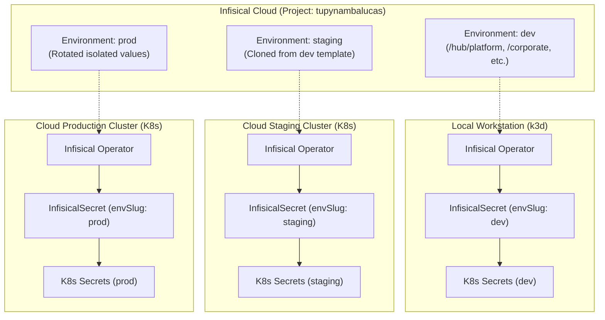
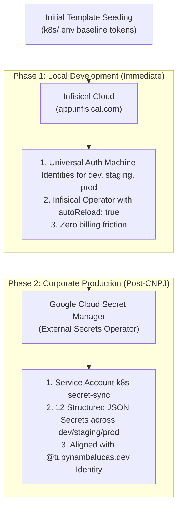

# Enterprise Secrets Management: Multi-Environment Architectural Guide

This document establishes the enterprise secret management architecture for the `tupynambalucas`
monorepo across **all three environments**: `dev`, `staging`, and `prod`.

It evaluates and provides complete, production-ready configuration runbooks for the three leading
approaches: **Infisical Cloud**, **Google Cloud Secret Manager (GSM)**, and **GitHub Environment
Secrets**. It also establishes the initial template seeding strategy, allowing identical baseline
tokens to be deployed initially across environments and rotated into isolated credentials later.

---

## 1. Architectural Comparison Matrix

| Evaluation Dimension         | Approach 1: Infisical Cloud                    | Approach 2: Google Cloud Secret Manager      | Approach 3: GitHub Environment Secrets      |
| :--------------------------- | :--------------------------------------------- | :------------------------------------------- | :------------------------------------------ |
| **Primary Domain**           | Dedicated Secret Management Platform           | Hyperscaler Cloud Secret Store               | CI/CD Pipeline Automation Store             |
| **Multi-Env Support**        | Native environments (`dev`, `staging`, `prod`) | Namespace/prefix separation per env          | GitHub Environments with review gates       |
| **Kubernetes Sync**          | Native Operator (`InfisicalSecret`) or ESO     | External Secrets Operator (`gcpsm`)          | CI/CD GitOps Push Workflow                  |
| **API Read/Write Model**     | Bidirectional (Full Read & Write)              | Bidirectional (Full Read & Write)            | **Write-Only by Design** (via REST API)     |
| **Web Dashboard**            | Developer-first UI (`app.infisical.com`)       | Google Cloud Console                         | GitHub Web UI (`Settings -> Environments`)  |
| **Onboarding Friction**      | **Zero card, zero deposit**; 30s signup        | **Requires active Billing** (Card or R$ 200) | **Zero card, zero deposit**; native to repo |
| **Secret Rotation & Reload** | Automated rolling update (`autoReload: true`)  | Automated ESO resync (60s polling)           | Triggered via GitHub Actions dispatch       |
| **Secret Versioning**        | Version history, point-in-time rollback        | Version numbers, enable/disable              | Overwrite only (no version history)         |
| **Identity & Access**        | Granular RBAC, Machine Identities              | Google Cloud Identity & IAM                  | GitHub Teams, Environment Reviewers         |
| **Compliance Level**         | SOC 2 Type II, ISO 27001                       | SOC 1/2/3, ISO, HIPAA, FedRAMP               | SOC 1/2, ISO 27001                          |

---

## 2. Initial Template Seeding Strategy Across Environments

To establish an immediate operational baseline across all six overlays without blocking deployment,
`staging` and `prod` can initially inherit template values mirrored from `dev`.

### Initial Template Baseline vs. Target Production Isolation

| Secret Key                          | Initial Template Value (Phase 1)        | Target Isolated Value (Phase 2)                  |
| :---------------------------------- | :-------------------------------------- | :----------------------------------------------- |
| `CLOUDFLARE_TUNNEL_TOKEN_HUB`       | Reused dev tunnel token                 | Dedicated tunnel token per cluster               |
| `CLOUDFLARE_TUNNEL_TOKEN_CORPORATE` | Reused dev tunnel token                 | Dedicated tunnel token per cluster               |
| `MONGO_USER`                        | `admin`                                 | `admin` (or dedicated app user)                  |
| `MONGO_PASSWORD`                    | Reused dev password                     | Unique, cryptographically generated password     |
| `MONGO_DB_NAME`                     | `tupynambalucas`                        | `tupynambalucas_staging` / `tupynambalucas_prod` |
| `REDIS_PASSWORD`                    | Reused dev password                     | Unique password per environment                  |
| `FASTIFY_JWT_SECRET`                | Reused dev secret                       | 64-character random cryptographic secret         |
| `PENPOT_PUBLIC_URI`                 | `https://penpot-dev.tupynambalucas.dev` | `https://penpot-stg...` / `https://penpot...`    |
| `PENPOT_EXPORTER_PUBLIC_URI`        | `https://penpot-exporter-dev...`        | `https://penpot-exporter-stg...`                 |
| `VITE_TURNSTILE_SITE_KEY`           | Reused dev Turnstile key                | Dedicated domain Turnstile key                   |

---

## 3. Approach 1: Infisical Cloud (Recommended for Immediate Dev & Multi-Env)

Infisical natively organizes secrets into isolated environments within a single project and
synchronizes them to Kubernetes via the official Infisical Operator.



### Infisical Project & Environment Setup

1. **Project Creation**: Create project `tupynambalucas` on [Infisical](https://app.infisical.com).
2. **Environment Configuration**: Infisical provides `dev`, `staging`, and `prod` out of the box.
3. **Template Seeding**:
   - Populate variables in the `dev` environment under four context paths:
     - `/hub/platform`: `CLOUDFLARE_TUNNEL_TOKEN_HUB`, `GRAFANA_ADMIN_PASSWORD`
     - `/hub/cortex`: `OPENAI_API_KEY`, `ANTHROPIC_API_KEY`, `COHERE_API_KEY`, `FIRECRAWL_API_KEY`
     - `/hub/studio`: `PENPOT_PUBLIC_URI`, `PENPOT_EXPORTER_PUBLIC_URI`, `PENPOT_SECRET_KEY`
     - `/corporate`: `CLOUDFLARE_TUNNEL_TOKEN_CORPORATE`, `MONGO_USER`, `MONGO_PASSWORD`,
       `MONGO_DB_NAME`, `REDIS_PASSWORD`, `FASTIFY_JWT_SECRET`, `VITE_TURNSTILE_SITE_KEY`,
       `VITE_CLOUDINARY_CLOUD_NAME`
   - Use Infisical's **Clone Secrets** action to duplicate all secrets from `dev` to `staging` and
     `prod`.
4. **Machine Identities Architecture & Provisioning Guide (Org vs. Project vs. All Tabs)**:

   Infisical distinguishes between **Organization Identities** and **Project Identities** to enforce strict multi-tenant isolation and least-privilege RBAC.

   #### Organization vs. Project vs. "All" Tab Architectural Breakdown

   | Scope / Tab                           | Dashboard Location                                                    | Blast Radius / Visibility                                                              | Best Suited Consumer                                   | Recommended Role                                 |
   | :------------------------------------ | :-------------------------------------------------------------------- | :------------------------------------------------------------------------------------- | :----------------------------------------------------- | :----------------------------------------------- |
   | **Organization Identity** (`Org` tab) | `Organization Settings` -> `Access Control` -> `Machine Identities`   | Cross-project; can be added to any project and call org-level APIs (`list-projects`)   | **AI Agent MCP Server** (`tupynambalucas-mcp-agent`)   | Org: `Member`<br/>Project: `Admin` (or `Member`) |
   | **Project Identity** (`Project` tab)  | `Project: tupynambalucas` -> `Access Control` -> `Machine Identities` | Isolated strictly to the single project; zero cross-project or org API access          | **Kubernetes Operators** (`tupynambalucas-*-operator`) | Project: `Viewer` (scoped by environment)        |
   | **"All" Filter Tab**                  | `Project` -> `Access Control` -> `Machine Identities` -> `All`        | Read/Filter view only; aggregates local Project Identities and assigned Org Identities | Dashboard management & auditing                        | N/A (View filter, not an entity type)            |

   > [!NOTE]
   > **How Built-in Project Roles Span Environments (`dev`, `staging`, `prod`)**:
   > In Infisical, the built-in project roles are **`Admin`**, **`Member`**, **`Viewer`**, and **`No Access`** (there is no built-in role named `Developer`).
   >
   > - When assigning **`Admin`** or **`Member`**, the role **inherently spans all environments (`dev`, `staging`, `prod`)** and all folders across the project. The dashboard modal does not require selecting individual checkboxes per environment because built-in roles have project-wide environmental scope by design.
   > - To restrict an identity to a single environment (e.g., `dev` only), use **Additional Privileges** or a **Custom Role** with environment conditions, or rely on the operator CRD `envSlug` targeting.

   ***

   #### Step-by-Step Provisioning Runbook

   ##### Step A: Provision AI Agent MCP Identity (`tupynambalucas-mcp-agent`)
   1. Navigate to **Organization Settings** -> **Access Control** -> **Machine Identities** (Organization level).
   2. Click **Create Identity**.
   3. Configure metadata:
      - **Name**: `tupynambalucas-mcp-agent`
      - **Organization Role**: Select `Member` (grants project access and org workspace read permissions).
      - **Auth Method**: Select `Universal Auth` (default).
   4. Click **Create**. Copy the generated **Client ID**.
   5. Open the identity details, select the **Client Secrets** tab, and click **Add Client Secret**:
      - **Description**: `antigravity-mcp-v1`
      - **TTL**: `0` (never expires)
      - **Max Number of Uses**: `0` (unlimited uses)
   6. Click **Create** and immediately copy the **Client Secret** (displayed only once).
   7. Navigate to the project: **Project: tupynambalucas** -> **Access Control** -> **Machine Identities**.
   8. Click **Add Machine Identity to Project** (the sheet automatically selects **Assign Existing** when reusable org identities exist).
   9. In the identity picker, select `tupynambalucas-mcp-agent`.
   10. In the **Role** dropdown, select **`Admin`** (full control over secrets and folders) or **`Member`** (read/write access to secrets). This automatically covers `dev`, `staging`, and `prod` environments without extra configuration.

   ##### Step B: Provision Kubernetes Cluster Operators (`tupynambalucas-*-operator`)

   For cluster operators, create dedicated identities per environment:
   1. Navigate to **Project: tupynambalucas** -> **Access Control** -> **Machine Identities** (Project level).
   2. Click **Add Machine Identity to Project** -> select **Create New** (or create under Org and assign).
   3. Configure names and assign the built-in project role **`Viewer`**:
      - Name: `tupynambalucas-dev-operator` -> Role: **`Viewer`**
      - Name: `tupynambalucas-staging-operator` -> Role: **`Viewer`**
      - Name: `tupynambalucas-prod-operator` -> Role: **`Viewer`**

      > [!IMPORTANT]
      > **UI Guidance for Free Plan Users**:
      > In the Infisical Dashboard, the role dropdown only lists `Viewer`, `Member`, `Admin`, and `No Access`. There are **no checkboxes or dropdowns for individual environments** (`dev`, `staging`, `prod`) inside the role assignment sheet.
      > On the **Free Plan**, select **`Viewer`**. The environment scoping is enforced in the Kubernetes cluster manifests via the operator CRD (`envSlug: dev`).

   4. **Environment Isolation Strategies & Plan Tier Constraints**:

      > [!IMPORTANT]
      > **UI Migration Notice: Additional Privileges Moved to Folder-Level Access**
      > In recent Infisical releases, path and environment restrictions have migrated from _Additional Privileges_ to **Folder-Level Access Controls (Folder RBAC)**. Folder-level grants override base project roles and persist even when folders are renamed or reorganized.
      >
      > **Tier Availability**:
      >
      > - **Free Plan (Immediate Local Phase)**: Built-in roles only (`Admin`, `Member`, `Viewer`, `No Access`). Folder RBAC is a Pro feature, and Custom Roles is an Enterprise feature.
      > - **Pro Plan / Self-Hosted (Enterprise Phase)**: Unlocks Folder-Level Access Controls (Folder RBAC).
      - **Option 1: Free Plan Standard Isolation (Workload CRD Scope)**:
        Assign the identity the built-in project role **`Viewer`**. The Infisical Kubernetes Operator CRD (`InfisicalSecret`) enforces environment isolation by explicitly declaring `envSlug: dev` in the cluster manifest.
        - _Trade-off_: Fully supported on the Free Plan without licensing friction. The token itself technically possesses project-wide read permissions if queried outside the cluster, but is scoped inside Kubernetes by the operator manifest.
      - **Option 2: Pro/Enterprise Strict API Isolation (Folder RBAC Overrides)**:
        Assign the identity the base project role **`No Access`** (or `Viewer`). Navigate to **Secrets** -> select environment `dev` -> click **Manage Access** above the secrets table -> click **Add Access** -> select `tupynambalucas-dev-operator` -> assign the **`Read`** folder role.
        - _Benefit_: Server-side cryptographic enforcement. The token can only read secrets within that specific environment and folder; attempts to read `staging` or `prod` return `403 Forbidden`. Requires a Pro plan or self-hosted deployment.

   5. For each operator identity, open its details page -> **Client Secrets** tab -> click **Add Client Secret** (`TTL: 0`, `Max Uses: 0`) using the naming standard:
      - For `tupynambalucas-dev-operator`: Description `k3d-dev-operator-v1`
      - For `tupynambalucas-staging-operator`: Description `cloud-staging-operator-v1`
      - For `tupynambalucas-prod-operator`: Description `cloud-prod-operator-v1`
   6. Save the generated `Client ID` and `Client Secret` into the Kubernetes Secret manifest `infisical-auth-credentials` in the corresponding cluster/namespace.

   ##### Step C: Optional Personal Access Tokens (PAT) for Developer CLI

   For individual developers performing ad-hoc terminal debugging:
   1. Click your user avatar (bottom-left) -> **User Settings** -> **Personal Access Tokens**.
   2. Click **Create Token**, specify a name (e.g., `lucas-workstation-cli`), and define expiration.
   3. Copy the token (`inf_...`) for use with `infisical login --token="<TOKEN>"`.

   #### Machine Identity & Secret Naming Taxonomy Matrix

   To ensure auditability, least-privilege tracking, and zero-downtime secret rotation across
   clusters, all identities and associated credentials adhere to this standardized naming taxonomy:

   | Layer / Target                 | Scope / Target Consumer                                      | Standard Name / Identifier                                                        | Purpose & Lifecycle Guidance                                                                                                     |
   | :----------------------------- | :----------------------------------------------------------- | :-------------------------------------------------------------------------------- | :------------------------------------------------------------------------------------------------------------------------------- |
   | **Machine Identity Name**      | Dev Cluster Operator                                         | `tupynambalucas-dev-operator`                                                     | Project identity assigned `Viewer` role; consumed by local `k3d` dev clusters.                                                   |
   | **Machine Identity Name**      | Staging Cluster Operator                                     | `tupynambalucas-staging-operator`                                                 | Project identity assigned `Viewer` role; consumed by staging cluster overlays.                                                   |
   | **Machine Identity Name**      | Production Cluster Operator                                  | `tupynambalucas-prod-operator`                                                    | Project identity assigned `Viewer` role; consumed by production cluster overlays.                                                |
   | **Machine Identity Name**      | AI Agent MCP Server                                          | `tupynambalucas-mcp-agent`                                                        | Org identity assigned Org `Member` and Project `Admin`; consumed by AI agents.                                                   |
   | **Client Secret Description**  | Dev Operator Token                                           | `k3d-dev-operator-v1`                                                             | Human-readable token label in Infisical. Use `-v2`, `-v3` for zero-downtime rotation.                                            |
   | **Client Secret Description**  | Staging Operator Token                                       | `cloud-staging-operator-v1`                                                       | Human-readable token label in Infisical. Supports blue/green token rotation.                                                     |
   | **Client Secret Description**  | Production Operator Token                                    | `cloud-prod-operator-v1`                                                          | Human-readable token label in Infisical. Supports blue/green token rotation.                                                     |
   | **Client Secret Description**  | AI Agent MCP Token                                           | `antigravity-mcp-v1`                                                              | Local workstation token label for Antigravity AI MCP server.                                                                     |
   | **Kubernetes Secret Resource** | All Namespaces (`platform`, `corporate`, `cortex`, `studio`) | `infisical-auth-credentials`                                                      | Target `kind: Secret` in Kubernetes referenced by `InfisicalSecret.spec.authentication.universalAuth.credentialsRef.secretName`. |
   | **Kubernetes Secret Keys**     | Operator Auth Payload                                        | `clientId` and `clientSecret`                                                     | Exact data keys required by the Infisical Kubernetes Operator CRD.                                                               |
   | **Environment Variables**      | MCP Configuration & Scripts                                  | `INFISICAL_UNIVERSAL_AUTH_CLIENT_ID`<br/>`INFISICAL_UNIVERSAL_AUTH_CLIENT_SECRET` | Standardized environment variables consumed by `mcp_config.json` and automation scripts.                                         |

   ##### Zero-Downtime Secret Rotation Runbook

   Infisical supports multiple concurrent active Client Secrets per Machine Identity. When rotating
   cluster or agent credentials:
   1. Navigate to the target Machine Identity -> **Client Secrets** tab.
   2. Click **Add Client Secret** with an incremented version (e.g., `cloud-prod-operator-v2`).
   3. Update the target Kubernetes Secret manifest (`infisical-auth-credentials`) or local
      configuration with the new `clientSecret`.
   4. Verify the Infisical Operator successfully authenticates and syncs secrets using the new
      credential.
   5. Return to the Infisical dashboard and safely revoke/delete the retired secret
      (`cloud-prod-operator-v1`).

   #### Architectural Evaluation: Why Universal Auth is the Optimal Method for Our Monorepo

   Infisical supports over 20 authentication methods (including Kubernetes Auth, Cloud IAM, OIDC, and Token Auth). **Universal Auth** was selected as the foundational standard for the following architectural reasons:

   | Evaluation Vector                | Universal Auth (Selected)                                                       | Kubernetes Auth                                                                                        | Token Auth                                         | Cloud IAM / OIDC                           |
   | :------------------------------- | :------------------------------------------------------------------------------ | :----------------------------------------------------------------------------------------------------- | :------------------------------------------------- | :----------------------------------------- |
   | **Local k3d / WSL2 Feasibility** | **100% Native**: Client-initiated outbound TLS to `app.infisical.com`.          | **Infeasible**: Infisical Cloud must reach the cluster's TokenReview API (fails behind NAT/127.0.0.1). | Feasible                                           | Infeasible for local offline workstations. |
   | **Cross-Consumer Unification**   | **Unified**: Powers K8s Operator, AI Agent MCP, and Developer CLI identically.  | K8s pods only; cannot authenticate local CLI or AI Agent MCP.                                          | Unified, but lacks granular lifecycle.             | Fragmented across providers.               |
   | **Security & Secret Zero**       | **High**: Short-lived dynamic JWTs, client secret TTL, and brute-force lockout. | High: Bound to K8s service account tokens.                                                             | **Low**: Long-lived static token without rotation. | High: Workload identity federation.        |
   | **Licensing Friction**           | **Zero Cost**: Available on all plans, including Free Cloud and Self-Hosted.    | Requires Enterprise Gateway if clusters are private/behind firewall.                                   | Zero Cost                                          | Zero Cost                                  |

   > [!TIP]
   > **Summary**: Universal Auth is the only method that operates seamlessly across our local `k3d` clusters in WSL2, the Antigravity AI Agent MCP Server, and the developer terminal CLI without requiring inbound firewall openings or enterprise proxy gateways.

   ***

### Cluster Manifests & Kustomize Overlays

#### Base Manifest (`k8s/manifests/corporate/infisical-corporate-secrets.yaml`)

```yaml
apiVersion: secrets.infisical.com/v1alpha1
kind: InfisicalSecret
metadata:
  name: corporate-secrets
  namespace: corporate
spec:
  hostAPI: https://app.infisical.com/api
  resyncInterval: 60
  autoReload: true
  authentication:
    universalAuth:
      secretsScope:
        projectSlug: platform-ez7a
        envSlug: dev
        secretsPath: /corporate
      credentialsRef:
        secretName: infisical-auth-credentials
        secretNamespace: corporate
  managedSecretReference:
    secretName: corporate-secrets
    secretNamespace: corporate
    creationPolicy: Owner
```

#### Staging Overlay Patch (`k8s/overlays/staging/corporate/patches/infisical.yaml`)

```yaml
apiVersion: secrets.infisical.com/v1alpha1
kind: InfisicalSecret
metadata:
  name: corporate-secrets
  namespace: corporate
spec:
  authentication:
    universalAuth:
      secretsScope:
        envSlug: staging
```

#### Production Overlay Patch (`k8s/overlays/prod/corporate/patches/infisical.yaml`)

```yaml
apiVersion: secrets.infisical.com/v1alpha1
kind: InfisicalSecret
metadata:
  name: corporate-secrets
  namespace: corporate
spec:
  authentication:
    universalAuth:
      secretsScope:
        envSlug: prod
```

### Infisical CLI Runbook

The official Infisical CLI provides direct secret manipulation from the terminal and enables
in-memory secret injection, eliminating plaintext `.env` files on developer machines.

#### Installation

- **Ubuntu WSL2 (`tupynambalucasdev-ubuntu`)**:

  ```bash
  curl -1sLf 'https://dl.cloudsmith.io/public/infisical/infisical-cli/setup.deb.sh' | sudo -E bash
  sudo apt-get update && sudo apt-get install -y infisical
  ```

- **Windows Host**:
  ```powershell
  winget install Infisical.InfisicalCLI
  ```

#### Authentication

- **Interactive Login**:

  ```bash
  infisical login
  ```

- **Headless / Machine Identity Login (Automation)**:
  ```bash
  infisical login --method=universal-auth \
    --client-id="<DEV_CLIENT_ID>" \
    --client-secret="<DEV_CLIENT_SECRET>"
  ```

#### Operational Commands

1. **Set or Update Secrets**:

   ```bash
   infisical secrets set CLOUDFLARE_TUNNEL_TOKEN_HUB="eyJh..." --env=dev --path=/hub/platform
   infisical secrets set MONGO_PASSWORD="SecureMongoPassword" --env=dev --path=/corporate
   ```

2. **List and Inspect Secrets**:

   ```bash
   infisical secrets --env=dev --path=/corporate
   infisical secrets get MONGO_PASSWORD --env=dev --path=/corporate
   ```

3. **In-Memory Process Injection (Zero Secrets on Disk)**:
   Launch development commands with secrets injected directly into process memory without creating
   any physical `.env` file:

   ```bash
   infisical run --env=dev --path=/corporate -- pnpm dev
   ```

4. **Export (When Offline Artifact is Required)**:
   ```bash
   infisical export --env=dev --path=/corporate --format=dotenv
   ```

---

### Infisical Official MCP Server (`@infisical/mcp`)

Infisical maintains an official Model Context Protocol (MCP) server published under
`@infisical/mcp` ([Infisical/infisical-mcp-server](https://github.com/Infisical/infisical-mcp-server)).
This server connects AI coding agents directly to the Infisical control plane via standardized
function calling.

```mermaid
flowchart LR
  AGENT["AI Assistant / Antigravity<br/>(Tool Calling)"] <-->|MCP Protocol (stdio/JSON-RPC)| MCP["@infisical/mcp Server<br/>(Node.js / npx)"]
  MCP <-->|REST API (TLS)| INFISICAL["Infisical Cloud API<br/>(https://app.infisical.com/api)"]
  INFISICAL <--> K8S["Kubernetes Clusters<br/>(via Infisical Operator)"]
```

#### MCP Server Environment Variables

| Variable                                 | Description                                       | Default / Valid Values                           |
| :--------------------------------------- | :------------------------------------------------ | :----------------------------------------------- |
| `INFISICAL_AUTH_METHOD`                  | Authentication mechanism                          | `universal-auth` (recommended) or `access-token` |
| `INFISICAL_UNIVERSAL_AUTH_CLIENT_ID`     | Universal Auth Machine Identity Client ID         | Required for `universal-auth`                    |
| `INFISICAL_UNIVERSAL_AUTH_CLIENT_SECRET` | Universal Auth Machine Identity Client Secret     | Required for `universal-auth`                    |
| `INFISICAL_TOKEN`                        | Personal or machine access token                  | Required for `access-token`                      |
| `INFISICAL_HOST_URL`                     | API endpoint URL                                  | `https://app.infisical.com`                      |
| `INFISICAL_MASK_SECRET_VALUES`           | Masks secret values as `<masked>` in tool outputs | `false` (set `true` for security in shared logs) |
| `INFISICAL_ENABLED_TOOLS`                | Comma-separated allowlist of exposed tools        | Omit to expose all tools                         |

#### Exposed MCP Tools & Parameter Contracts

| MCP Tool Name        | Required Parameters                          | Optional Parameters                          | Behavioral Contract                                                                           |
| :------------------- | :------------------------------------------- | :------------------------------------------- | :-------------------------------------------------------------------------------------------- |
| `list-projects`      | None                                         | `type` (`"all"`, `"secret-manager"`, etc.)   | Queries `/api/v1/workspace` to discover project IDs and available environments across the org |
| `list-secrets`       | `projectId`, `environmentSlug`               | `secretPath` (default: `"/"`)                | Lists all secrets and their metadata in the specified project, environment, and folder        |
| `get-secret`         | `projectId`, `environmentSlug`, `secretName` | `secretPath` (default: `"/"`)                | Retrieves decrypted secret value and version metadata                                         |
| `create-secret`      | `projectId`, `environmentSlug`, `secretName` | `secretValue`, `secretPath` (default: `"/"`) | Creates a new secret key-value pair under the designated path                                 |
| `update-secret`      | `projectId`, `environmentSlug`, `secretName` | `secretValue`, `secretPath` (default: `"/"`) | Updates an existing secret without altering adjacent keys                                     |
| `delete-secret`      | `projectId`, `environmentSlug`, `secretName` | `secretPath` (default: `"/"`)                | Safely removes obsolete secrets from the vault                                                |
| `create-folder`      | `projectId`, `environmentSlug`, `folderName` | `path` (default: `"/"`)                      | Provisions new folder hierarchies (e.g., `/hub/platform`, `/corporate`)                       |
| `create-environment` | `projectId`, `name`, `slug`                  | None                                         | Defines new deployment targets (`dev`, `staging`, `prod`)                                     |

> [!IMPORTANT]
> **Why the AI Agent Identity Requires Organization + Project Binding**:
> The `list-projects` tool executes an HTTP GET to `/api/v1/workspace`. For this call to resolve without a `401/403 Forbidden` error, the Machine Identity (`tupynambalucas-mcp-agent`) must be created at the **Organization Level** with at least the `Member` role. Subsequently, to manage secrets within the `tupynambalucas` repository, the identity must be assigned to **Project: tupynambalucas** with `Admin` or `Developer` permissions. If created only as a local Project Identity, the agent will not be able to list projects or discover workspace IDs dynamically.

#### MCP Agent Configuration (`.agents/plugins/secrets-expert/mcp_config.json`)

The workspace plugin `secrets-expert` encapsulates the official Infisical MCP server definition:

```json
{
  "mcpServers": {
    "infisical-mcp": {
      "command": "pnpm",
      "args": ["dlx", "@infisical/mcp"],
      "env": {
        "INFISICAL_HOST_URL": "https://app.infisical.com",
        "INFISICAL_AUTH_METHOD": "universal-auth",
        "INFISICAL_UNIVERSAL_AUTH_CLIENT_ID": "<MACHINE_IDENTITY_CLIENT_ID>",
        "INFISICAL_UNIVERSAL_AUTH_CLIENT_SECRET": "<MACHINE_IDENTITY_CLIENT_SECRET>",
        "INFISICAL_MASK_SECRET_VALUES": "false"
      }
    }
  }
}
```

#### Agent Operational Workflow

With this MCP integration active:

1. The developer instructs the agent: _"Update `CLOUDFLARE_TUNNEL_TOKEN_HUB` in `dev` and `staging`"_.
2. The agent calls `update-secret` against the Infisical API using the scoped Machine Identity.
3. The Infisical Operator in the cluster detects the update within 60 seconds and triggers an
   automated rolling update (`autoReload: true`) of the dependent `cloudflared` deployment.
4. Zero plaintext secrets are stored in Git, local filesystems, or manual copy-paste buffers.

---

## 4. Approach 2: Google Cloud Secret Manager & External Secrets Operator

Google Cloud Secret Manager (GSM) organizes multi-environment secrets using structured JSON
payloads per environment prefix, consumed by the CNCF External Secrets Operator (ESO).

### GCP Secret Taxonomy per Environment

| Secret Name in Google Cloud        | Environment | Target Kubernetes Secret | Namespace   |
| :--------------------------------- | :---------- | :----------------------- | :---------- |
| `tupynambalucas-dev-platform`      | `dev`       | `platform-secrets`       | `platform`  |
| `tupynambalucas-dev-corporate`     | `dev`       | `corporate-secrets`      | `corporate` |
| `tupynambalucas-dev-cortex`        | `dev`       | `cortex-secrets`         | `cortex`    |
| `tupynambalucas-dev-studio`        | `dev`       | `studio-secrets`         | `studio`    |
| `tupynambalucas-staging-platform`  | `staging`   | `platform-secrets`       | `platform`  |
| `tupynambalucas-staging-corporate` | `staging`   | `corporate-secrets`      | `corporate` |
| `tupynambalucas-staging-cortex`    | `staging`   | `cortex-secrets`         | `cortex`    |
| `tupynambalucas-staging-studio`    | `staging`   | `studio-secrets`         | `studio`    |
| `tupynambalucas-prod-platform`     | `prod`      | `platform-secrets`       | `platform`  |
| `tupynambalucas-prod-corporate`    | `prod`      | `corporate-secrets`      | `corporate` |
| `tupynambalucas-prod-cortex`       | `prod`      | `cortex-secrets`         | `cortex`    |
| `tupynambalucas-prod-studio`       | `prod`      | `studio-secrets`         | `studio`    |

### GCP Initial Seeding via CLI Script (`k8s/scripts/seed-gcp-secrets.sh`)

```bash
#!/usr/bin/env bash
set -euo pipefail

PROJECT_ID="${1:-tupynambalucas-infra}"
TEMPLATE_FILE="k8s/.env"

echo "==> Seeding Google Secret Manager secrets from $TEMPLATE_FILE"

# Parse .env into JSON
PLATFORM_JSON=$(jq -n \
  --arg hub_token "$(grep CLOUDFLARE_TUNNEL_TOKEN_HUB "$TEMPLATE_FILE" | cut -d= -f2-)" \
  --arg grafana_pw "AdminSecr3t!" \
  '{CLOUDFLARE_TUNNEL_TOKEN_HUB: $hub_token, GRAFANA_ADMIN_PASSWORD: $grafana_pw}')

CORPORATE_JSON=$(jq -n \
  --arg corp_token "$(grep CLOUDFLARE_TUNNEL_TOKEN_CORPORATE "$TEMPLATE_FILE" | cut -d= -f2-)" \
  --arg mongo_pw "MongoSecr3t!" \
  --arg redis_pw "RedisSecr3t!" \
  --arg jwt_sec "JwtSuperSecretKey2026!" \
  '{CLOUDFLARE_TUNNEL_TOKEN_CORPORATE: $corp_token, MONGO_USER: "admin", MONGO_PASSWORD: $mongo_pw, MONGO_DB_NAME: "tupynambalucas", REDIS_PASSWORD: $redis_pw, FASTIFY_JWT_SECRET: $jwt_sec}')

# Seed across dev, staging, prod
for env in dev staging prod; do
  for context in platform corporate; do
    SECRET_NAME="tupynambalucas-${env}-${context}"
    PAYLOAD_VAR="${context^^}_JSON"

    if ! gcloud secrets describe "$SECRET_NAME" --project="$PROJECT_ID" >/dev/null 2>&1; then
      gcloud secrets create "$SECRET_NAME" --replication-policy="automatic" --project="$PROJECT_ID"
    fi
    echo -n "${!PAYLOAD_VAR}" | gcloud secrets versions add "$SECRET_NAME" --data-file=- --project="$PROJECT_ID"
    echo "Created version for $SECRET_NAME"
  done
done
```

### Kustomize Overlays for ESO

#### Staging Patch (`k8s/overlays/staging/corporate/patches/eso.yaml`)

```yaml
apiVersion: external-secrets.io/v1
kind: ExternalSecret
metadata:
  name: corporate-secrets
  namespace: corporate
spec:
  dataFrom:
    - extract:
        key: tupynambalucas-staging-corporate
```

#### Production Patch (`k8s/overlays/prod/corporate/patches/eso.yaml`)

```yaml
apiVersion: external-secrets.io/v1
kind: ExternalSecret
metadata:
  name: corporate-secrets
  namespace: corporate
spec:
  dataFrom:
    - extract:
        key: tupynambalucas-prod-corporate
```

---

## 5. Approach 3: GitHub Environment Secrets & GitOps Push Pipeline

Because GitHub Secrets are **write-only via API** (encrypted with Libsodium public keys) and cannot be pulled directly by Kubernetes clusters or local workloads, the enterprise pattern uses a **GitHub Actions Push Workflow** to inject secrets into target clusters, complemented by repository synchronization scripts.

### Repository Infrastructure Tooling (`tools/github/services/gh`)

The repository includes a native automation script: [`tools/github/services/gh/extensions/ext_sync_secrets.sh`](../../tools/github/services/gh/extensions/ext_sync_secrets.sh), which operates alongside [`tools/github/services/gh/config/secrets.env.json`](../../tools/github/services/gh/config/secrets.env.example.json) and `variables.env.json`.

#### Operational Flow of `ext_sync_secrets.sh`:

1. **Category Parsing**: Scans `secrets.env.json` using `jq` across three top-level categories: `ACTIONS`, `CODESPACES`, and `DEPENDABOT`.
2. **Symmetrical Pruning**: Queries `gh secret list --app <category>` and deletes any secret from GitHub that was removed from the local JSON config.
3. **Symmetrical Upsert**: Iterates through local keys and executes `gh secret set <KEY> --body <VAL> --app <category>`, keeping GitHub in sync with local configurations.
4. **Variable Synchronization**: Symmetrically syncs non-sensitive configuration keys via `gh variable set` and `gh variable delete` under the `ACTIONS` scope.

---

### Architectural & Security Assessment: Is Approach 3 the Most Professional?

**Verdict: NO. GitHub Secrets alone is NOT the most professional approach for application secrets management and Kubernetes runtime workloads.**

#### Detailed Architectural Comparison

| Security / Operational Criterion | Dedicated Vault (Infisical / GSM)                                                     | GitHub Secrets + `ext_sync_secrets.sh`                                                        |
| :------------------------------- | :------------------------------------------------------------------------------------ | :-------------------------------------------------------------------------------------------- |
| **Architectural Model**          | **Pull Model (Zero Trust)**: Kubernetes operators pull secrets directly on demand.    | **Push Model**: External pipeline or developer CLI pushes secrets into clusters.              |
| **API Read Access**              | **Bidirectional**: Full read/write with RBAC audit logging.                           | **Write-Only by Design**: Secrets cannot be read back via API once set.                       |
| **Local Disk Security**          | **Zero Plaintext on Disk**: Secrets injected into runtime memory via `infisical run`. | **Plaintext on Disk**: Requires unencrypted `secrets.env.json` or `.env` to run sync scripts. |
| **Local k3d / WSL2 Support**     | **Native**: Pods query cofre via internal container network or cloud TLS.             | **Broken for Local**: Cloud GitHub Actions runners cannot reach `127.0.0.1` / WSL2.           |
| **Secret Versioning & Rollback** | **Supported**: Every revision is tracked with rollback capability.                    | **Unsupported**: Overwrites current value; zero version history.                              |
| **Pod Auto-Reload**              | **Supported (`autoReload: true`)**: Rolling restart upon secret change.               | **Unsupported**: Requires full pipeline re-execution and redeploy.                            |

> [!CAUTION]
> **Why GitHub Secrets is an Antipatern as a Primary Application Vault**:
>
> 1. **Upstream ESO Limitation**: The official CNCF External Secrets Operator documentation explicitly confirms:
>    > _"The GitHub provider is write-only, designed specifically to create and update GitHub Actions or Dependabot secrets... and does not support fetching secret values."_
>    > Kubernetes cannot use GitHub as a secret provider; it can only push _to_ GitHub.
> 2. **Plaintext Secret Sprawl**: Using `ext_sync_secrets.sh` as the primary secret store requires maintaining `tools/github/services/gh/config/secrets.env.json` on developer laptops. If a laptop is compromised or lost, all production and staging secrets are exposed in plaintext.
> 3. **Firewall / NAT Barrier**: For local development clusters (`k3d-hub`, `k3d-corporate`), GitHub Actions runners in the cloud cannot execute `kubectl apply` without exposing internal cluster endpoints to the public internet.

#### Where `ext_sync_secrets.sh` IS Genuinely Useful & Recommended

`ext_sync_secrets.sh` is an outstanding **CI/CD Infrastructure Provisioning Engine**:

- **GitHub-Specific Automation**: Ideal for populating pipeline tokens needed strictly by GitHub Actions (`DOCKERHUB_TOKEN`, `SONAR_TOKEN`, `CODECOV_TOKEN`), Dependabot (`PRIVATE_REGISTRY_TOKEN`), and Codespaces configurations.
- **Enterprise Hybrid Synergy**: In an advanced pipeline, `secrets.env.json` is eliminated from disk entirely; instead, `ext_sync_secrets.sh` or the native Infisical-to-GitHub integration reads secrets dynamically from Infisical and syncs them to GitHub Actions.

---

### GitHub Environments Setup (For CI/CD Pipelines)

Configure three environments under repository **Settings** -> **Environments**:

1. **`dev` Environment**:
   - Deployment branches: All branches allowed.
   - Protection rules: None (instant synchronization).
2. **`staging` Environment**:
   - Deployment branches: Limited to `develop` and `staging`.
   - Protection rules: Wait timer (optional).
3. **`prod` Environment**:
   - Deployment branches: Strictly limited to `main`.
   - Protection rules: **Required reviewers** enabled (requires repository Owner approval before
     secrets can be deployed to production).

### Automated GitOps Secrets Synchronization Workflow (`.github/workflows/sync-secrets.yaml`)

```yaml
name: Sync Secrets to Kubernetes

on:
  workflow_dispatch:
    inputs:
      target_env:
        description: 'Target Environment'
        required: true
        default: 'dev'
        type: choice
        options:
          - dev
          - staging
          - prod

jobs:
  push-secrets:
    name: Hydrate Kubernetes Secrets
    runs-on: ubuntu-latest
    environment: ${{ inputs.target_env }}

    steps:
      - name: Checkout Code
        uses: actions/checkout@v4

      - name: Set Kubernetes Context
        uses: azure/k8s-set-context@v4
        with:
          method: kubeconfig
          kubeconfig: ${{ secrets.KUBECONFIG }}

      - name: Deploy Hub Secrets
        run: |
          kubectl create namespace platform --dry-run=client -o yaml | kubectl apply -f -
          kubectl create secret generic platform-secrets \
            --namespace platform \
            --from-literal=CLOUDFLARE_TUNNEL_TOKEN_HUB="${{ secrets.CLOUDFLARE_TUNNEL_TOKEN_HUB }}" \
            --from-literal=GRAFANA_ADMIN_PASSWORD="${{ secrets.GRAFANA_ADMIN_PASSWORD }}" \
            --dry-run=client -o yaml | kubectl apply -f -

      - name: Deploy Corporate Secrets
        run: |
          kubectl create namespace corporate --dry-run=client -o yaml | kubectl apply -f -
          kubectl create secret generic corporate-secrets \
            --namespace corporate \
            --from-literal=CLOUDFLARE_TUNNEL_TOKEN_CORPORATE="${{ secrets.CLOUDFLARE_TUNNEL_TOKEN_CORPORATE }}" \
            --from-literal=MONGO_USER="admin" \
            --from-literal=MONGO_PASSWORD="${{ secrets.MONGO_PASSWORD }}" \
            --from-literal=MONGO_DB_NAME="tupynambalucas" \
            --from-literal=REDIS_PASSWORD="${{ secrets.REDIS_PASSWORD }}" \
            --from-literal=FASTIFY_JWT_SECRET="${{ secrets.FASTIFY_JWT_SECRET }}" \
            --dry-run=client -o yaml | kubectl apply -f -
```

### Seeding GitHub Secrets via GitHub CLI

Seed initial template values across all three GitHub environments using `gh secret set`:

```bash
# Seed dev
gh secret set CLOUDFLARE_TUNNEL_TOKEN_HUB --env dev < token_hub.txt
gh secret set CLOUDFLARE_TUNNEL_TOKEN_CORPORATE --env dev < token_corporate.txt

# Seed staging with template values
gh secret set CLOUDFLARE_TUNNEL_TOKEN_HUB --env staging < token_hub.txt
gh secret set CLOUDFLARE_TUNNEL_TOKEN_CORPORATE --env staging < token_corporate.txt

# Seed prod with template values
gh secret set CLOUDFLARE_TUNNEL_TOKEN_HUB --env prod < token_hub.txt
gh secret set CLOUDFLARE_TUNNEL_TOKEN_CORPORATE --env prod < token_corporate.txt
```

---

## 6. Phased Strategy & Implementation Checklist



### Execution Checklist

- [ ] Select primary initial provider: **Infisical Cloud** (zero credit card friction).
- [ ] Seed baseline tokens from `k8s/.env` into `dev`, `staging`, and `prod` environments.
- [ ] Install cluster operator (`infisical-operator` for Infisical or `external-secrets` for GSM).
- [ ] Configure `InfisicalSecret` or `ExternalSecret` manifests and verify Kustomize overlays.
- [ ] Confirm tunnel pods transition to **HEALTHY** in Cloudflare Zero Trust without local `.env`.
- [ ] Rotate `staging` and `prod` tokens once dedicated cloud environments are provisioned.
