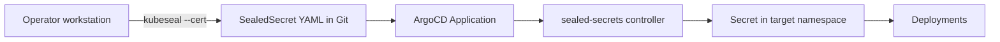

# Secrets Management for Staging and Prod

Defines how Kubernetes Secrets reach the `staging` and `prod` clusters. `dev` keeps the local
`k8s/.env` and Kustomize `secretGenerator`. Related to the open decision 3 in
[Enterprise architecture review](./enterprise-architecture-review.md).

## 1. Problem

- The `staging` and `prod` overlays cannot read `k8s/.env`. It is untracked and ArgoCD only sees
  the Git repository.
- The corporate `staging` and `prod` overlays no longer generate `corporate-secrets`. The hub
  `staging` and `prod` overlays still point to `.env`, which does not work under GitOps.
- A single `.env` cannot hold values that differ per environment (for example
  `PENPOT_PUBLIC_URI`).
- Six Cloudflare tunnel tokens exist, and each cluster needs only its own.

## 2. Options

All three options end with a regular Kubernetes `Secret` in etcd. They differ in where the real
value lives and who can decrypt it.

| Aspect             | Sealed Secrets                                      | SOPS                                              | External Secrets Operator                            |
| :----------------- | :-------------------------------------------------- | :------------------------------------------------ | :--------------------------------------------------- |
| What it is         | In-cluster controller. `kubeseal` encrypts offline. | File encryption with age or a cloud KMS.          | Operator that syncs a secret from an external store. |
| Stored in Git      | `SealedSecret` ciphertext                           | Encrypted YAML, field names readable              | `ExternalSecret` pointer only                        |
| Who can decrypt    | Only the controller of that cluster                 | Anyone holding the age or KMS key                 | Whoever the external store authorizes                |
| Rotation           | Seal again and commit                               | Encrypt again and commit                          | Change it in the store, it propagates                |
| Several clusters   | Seal once per cluster                               | One key shared by all clusters                    | One remote key serves all clusters                   |
| Cold rebuild       | Fails unless the controller key is restored         | Works if the key is restored                      | Needs the store reachable and authenticated          |
| ArgoCD integration | Native, no plugin                                   | Needs a plugin (KSOPS) and the key in repo-server | Native, no plugin                                    |
| Extra dependency   | None                                                | Key distribution                                  | An external secret store                             |
| Main risk          | Losing the controller key loses the secrets         | Key sprawl and manifest-time decryption           | Store outage blocks secret creation                  |

ArgoCD guidance: populate secrets on the destination cluster (Sealed Secrets or ESO) instead of
during manifest generation. ArgoCD caches generated manifests in plain text in Redis, which makes
manifest-time decryption (SOPS plugin) riskier.

Sources: Context7 (`/bitnami/sealed-secrets`, `/external-secrets/external-secrets`,
`/getsops/sops`), the ArgoCD secret management documentation, and the StackHarbor comparison of
the three tools.

## 3. Decision

Use **Sealed Secrets** for `staging` and `prod`.

Reasons:

- Four cloud clusters and no external secret store chosen yet. ESO would require choosing and
  operating one.
- No ArgoCD plugin and no key distribution.
- Secrets are decrypted only inside the target cluster.
- The repository stays self-contained for review.

Accepted trade-offs:

- Each secret is sealed once per cluster (4 times).
- The controller sealing key of each cluster MUST be backed up. Without it, a rebuilt cluster
  requires new secret values.

Migration path to External Secrets Operator: an `ExternalSecret` produces a `Secret` with the same
name and keys as the `SealedSecret` it replaces. No Deployment changes. Switch when the clusters
run on a provider with a native secret manager.

## 4. Target Design

- One `sealed-secrets` controller per cluster, installed by its own ArgoCD Application with an
  earlier sync wave than the overlay Application.
- One plaintext source file per environment and context, kept outside Git:
  `k8s/secrets/<env>/<context>.env` (ignored by Git). Example: `k8s/secrets/prod/hub.env`.
- One generated `SealedSecret` file per Secret and cluster, committed:
  `k8s/overlays/<env>/<context>/sealed-secrets/<name>.yaml`.
- Default scope is `strict`. A `SealedSecret` is bound to its name and namespace.

### Secrets per cluster

| Cluster                        | Secrets                                                |
| :----------------------------- | :----------------------------------------------------- |
| `staging` and `prod` hub       | `platform-secrets`, `cortex-secrets`, `studio-secrets` |
| `staging` and `prod` corporate | `corporate-secrets`                                    |

Each Secret keeps the same name and keys used by `dev`, so base manifests do not change.
`platform-secrets` in the hub holds `CLOUDFLARE_TUNNEL_TOKEN_HUB` and `corporate-secrets` holds
`CLOUDFLARE_TUNNEL_TOKEN_CORPORATE`. Each cluster receives only its own tunnel token.

### Per-environment values

Values that differ per environment move from the shared `.env` to the per-environment source
files. Known cases: `PENPOT_PUBLIC_URI`, `PENPOT_EXPORTER_PUBLIC_URI`, `MONGO_URI`,
`NODE_ENV`, `APP_ENV`, `GRAFANA_URL`, and the Cloudflare tunnel tokens.

## 5. Implementation Steps

1. Add `k8s/secrets/` to `.gitignore` and create `k8s/secrets/<env>/<context>.env.example` files
   with uppercase placeholders (no real values).
2. Add an ArgoCD Application for the `sealed-secrets` controller per cluster, with sync wave `-1`.
3. Add `k8s/scripts/seal-secrets.sh <env> <context>`: fetches the cluster certificate with
   `kubeseal --fetch-cert`, reads the matching `.env`, and writes one `SealedSecret` per Secret into
   `overlays/<env>/<context>/sealed-secrets/`.
4. Remove `secretGenerator` from the hub `staging` and `prod` overlays. Add the `sealed-secrets`
   folder to their `resources`.
5. Add the `sealed-secrets` folder to the corporate `staging` and `prod` overlays.
6. Back up each controller key right after installation:
   `kubectl get secret -n kube-system -l sealedsecrets.bitnami.com/sealed-secrets-key -o yaml`.
   Store the backup outside the cluster and outside Git. Repeat after a key renewal.
7. Document the rotation procedure: edit the source `.env`, rerun the script, commit the new
   `SealedSecret`. Restart consumers because Kubernetes does not restart Pods on Secret change.
8. Update `k8s/references` (secrets section, environments reference) and the Ubuntu setup plan
   (install `kubeseal`).

## 6. Validation

- `kubectl kustomize --load-restrictor=LoadRestrictionsNone k8s/overlays/<env>/<context>` renders for
  all six overlays, and the `staging` and `prod` output contains `SealedSecret` kinds and no
  plaintext values.
- `grep` over `k8s/overlays` and `k8s/manifests` finds no tunnel token, password, or key.
- After sync, `kubectl get secret -n <namespace>` shows the unsealed Secrets and
  `kubectl get sealedsecret -A` reports them as synced.
- The `cloudflared` pod of each cluster registers tunnel connections.
- Deleting the controller key backup test: restore it into a scratch cluster and confirm the same
  `SealedSecret` decrypts.

## 7. Security Notes

- The backup `.env.prod` in `tupynambalucas-backup` contains a real MongoDB Atlas password. Rotate
  `elo-admin-prod` and delete the file after the review.
- The prod tunnel tokens and database credentials MUST be generated new for `staging` and `prod`.
  Do not reuse the `dev` values.
- Encryption at rest for etcd and restricted `get secrets` RBAC are required in addition to this
  mechanism, because every option ends with a plain Secret in etcd.

## 8. Open Items

- Confirm the choice of Sealed Secrets.
- Confirm where the controller key backups are stored.
- Choose the cloud provider, which also determines the future ESO store.
