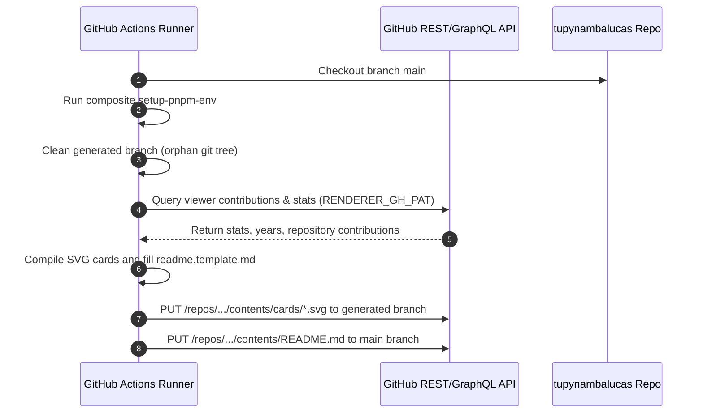

# Personal Profile Renderer and Identity Architecture

This document establishes the architecture, pipeline orchestration, asset organization, and GitHub token security standards for the personal GitHub profile repository (`tupynambalucas/tupynambalucas`).

---

## 1. Executive Archetype and Identity Context

The personal profile repository serves as the sovereign public showcase for **Tupynambá Lucas**, whose verified engineering profile is:

**Principal Platform & AI Systems Architect / Founding Systems Architect**

### Core Foundational Pillars

1. **Meta-Repository & Multi-Repo Orchestration (`org-core`)**: Master umbrella architecture orchestrating federated repositories via Git Submodules (`platform`, `agent-toolkit`, `docs`, `.github`), automated 5-pillar workstation convergence, and deterministic submodule pointer synchronizations.
2. **Cloud-Native Platform & GitOps (`platform`)**: Multi-cluster local and cloud Kubernetes orchestration (`k3d`, Skaffold, Helm, Kustomize), continuous GitOps deployments via ArgoCD, Cloudflare Zero Trust edge tunnels, Traefik v3 ingress controllers, Fastify 5 microservices, BullMQ job queues, and ACID multi-document MongoDB replica sets.
3. **Autonomous AI Substrate & Agentic Infrastructure (`agent-toolkit`)**: Self-hosted Model Context Protocol (MCP) gateways, policy-enforced guardrails using Common Expression Language (CEL), vector RAG layers, and enterprise autonomous agent customization frameworks (Antigravity).
4. **Real-Time Graphics & High-Performance Engines (`tessel`)**: Low-level systems engineering, WebAssembly (Wasm), WebGL/WebGPU graphics pipelines, and deterministic game runtime architectures.
5. **Sovereign Documentation Architecture (`docs`)**: Enterprise knowledge hubs structured strictly under the Diátaxis framework (Tutorials, How-To Guides, Technical Reference, Explanations) built with Docusaurus v3 and Crowdin localization.
6. **Zero-Trust Security & Cryptographic Invariants**: SSH cryptographic commit signing (`git commit -S`), Infisical Universal Auth secret management, Zero-Emoji invariant, and Conventional Commits v1.0.0.

---

## 2. Monorepo Architecture and Assets Topology

The repository operates as a Turborepo monorepo orchestrated with pnpm workspaces:

```
tupynambalucas (Root Profile Repository)
├── .agents/
│   └── plans/
│       └── personal-profile-renderer-and-identity-architecture.md
├── .github/
│   ├── actions/
│   │   ├── generate-renderer/
│   │   │   └── action.yaml
│   │   └── setup-pnpm-env/
│   │       └── action.yaml
│   └── workflows/
│       └── renderer-generate.yml
├── generated/
│   └── cards/
│       ├── static/
│       │   └── github-header.svg
│       └── stats/
│           ├── languages.svg
│           └── overview.svg
├── renderer/
│   ├── src/
│   │   ├── clients/
│   │   │   └── github.ts
│   │   ├── config/
│   │   │   └── env.config.ts
│   │   ├── pipelines/
│   │   │   ├── conduct/
│   │   │   ├── license/
│   │   │   └── readme/
│   │   │       ├── readme.pipeline.ts
│   │   │       └── readme.template.md
│   │   ├── renderers/
│   │   │   └── stats-card.ts
│   │   ├── schemas/
│   │   └── index.ts
│   └── package.json
└── shared/
    ├── assets/
    │   ├── src/
    │   │   ├── fonts/
    │   │   ├── icons/
    │   │   ├── images/
    │   │   ├── org/            <-- Migrated from brand/ for organizational asset parity
    │   │   │   ├── banners/
    │   │   │   ├── favicons/
    │   │   │   ├── guidelines/
    │   │   │   ├── logos/
    │   │   │   ├── palettes/
    │   │   │   └── persona/
    │   │   ├── renderer/
    │   │   │   └── github/
    │   │   │       └── cards/
    │   │   └── tokens/
    │   └── package.json
    ├── config/
    │   └── src/
    │       └── project.config.ts
    └── git/
```

### Shared Assets Modernization (`brand/` -> `org/`)

- The internal folder `shared/assets/src/brand` has been renamed to `shared/assets/src/org` to support organizational brand ownership and institutional assets alongside personal brand identity.
- The package export in `shared/assets/package.json` provides:
  - `./logos`: Points to `./src/org/logos/index.ts`
  - `./logos/*`: Points to `./src/org/logos/*`
  - `./org/*`: Points to `./src/org/*`
  - `./brand/*`: Maintained as an alias to `./src/org/*` to guarantee backward compatibility.
- `assets-manifest.json` updated with `/org` bucket entry.

---

## 3. Dynamic Rendering Pipeline Architecture

The document generator executes in two phases:

1. **GitHub API Ingestion**:
   - Queries user GraphQL schema (`viewer`, `contributionsCollection`, contribution years).
   - Queries contributor statistics across all active repositories (recursively splitting time ranges if 100 repositories threshold is reached).
   - Attempts repository traffic view ingestion (`/traffic/views`). If forbidden (403), gracefully degrades and defaults to 0.
   - Computes total additions, deletions, commits, PRs, code reviews, and repositories.
2. **Template Compilation & Asset Synthesis**:
   - **Static Header**: Reads `github-header.svg` from `@tupynambalucas/studio-assets`.
   - **Stats Cards**: Inlines variable brand fonts (`Nunito`), compiles `overview.svg` and `languages.svg` with exact design tokens.
   - **Markdown Documents**: Compiles `README.md`, `LICENSE.md`, and `CODE_OF_CONDUCT.md` via regex placeholder interpolation (`{{ var }}` and `%CONFIG_KEY%`).
   - In CI/CD mode (`GITHUB_ACTIONS=true`), directly commits updated SVGs to the `generated` branch and pushes updated markdown files to the target branch (`main`).

---

## 4. GitHub Actions Workflow and Token Governance

The workflow `.github/workflows/renderer-generate.yml` runs daily at midnight (`0 0 * * *`) or manually via `workflow_dispatch`.



### Secret Token Requirement: `RENDERER_GH_PAT`

The action requires a Personal Access Token stored as an Action Secret named `RENDERER_GH_PAT` in repository `tupynambalucas/tupynambalucas`.

#### Option A: Fine-Grained Personal Access Token (Recommended)

1. **Token Name**: `Tupynamba Lucas Profile Renderer PAT`
2. **Expiration**: 90 days or custom (must be renewed periodically).
3. **Resource Owner**: `tupynambalucas` (Personal Account).
4. **Repository Access**:
   - **All repositories** (Required so the generator can query stats, contributions, and commits across all personal and organizational repositories).
   - _Note_: If restricted to "Only select repositories", the stats card will only include selected repositories.
5. **Permissions**:
   - **Repository Permissions**:
     - `Contents`: **Read and write** (Mandatory: Allows committing `README.md` to `main` and SVG cards to `generated`).
     - `Metadata`: **Read-only** (Mandatory default).
     - `Administration`: **Read-only** (Optional: Required if repository traffic views `/traffic/views` are desired without 403 status).
   - **Account Permissions**:
     - `Email addresses`: **Read-only** (Mandatory: Allows matching author emails for contribution lines calculation).
     - `Profile`: **Read-only** (Optional).

#### Option B: Classic Personal Access Token

If Fine-Grained access across organization repositories is restricted:

- **Scopes**:
  - `repo` (Full control of private repositories).
  - `read:user` (Read user profile data).
  - `user:email` (Access user email addresses).

---

## 5. Local Execution and Verification Standard

To test and run the generator locally:

```powershell
# In repository root: C:\Users\tupyn\projects\personal\profile
pnpm --filter @tupynambalucas/renderer generate
```

Requirements for local run:

- A `.env` file inside `renderer/` containing:
  ```env
  RENDERER_GH_PAT="github_pat_..."
  ```
- Local execution updates `README.md`, `LICENSE.md`, `CODE_OF_CONDUCT.md`, and writes SVGs to `generated/cards/` without calling GitHub PUT endpoints.
