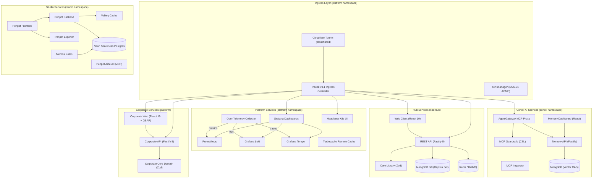

# Platform Monorepo

The core platform monorepo powering the %PROJECT_DOMAIN% ecosystem. Built on TypeScript, Fastify 5, React 19, PNPM Workspaces, and Turborepo with Kubernetes-native orchestration via Skaffold and k3d.

> [!NOTE]
> **Documentation Hub:** Full architectural deep dives, Diátaxis guides, and tutorials are available at [https://docs.tupynambalucas.dev](https://docs.tupynambalucas.dev) and hosted sovereignly in the [`docs`](https://github.com/tupynambalucas-dev/docs) repository.

---

## 1. Architecture Overview

The codebase is organized into isolated **Bounded Contexts**, each owning its own domain logic, infrastructure manifests, and lifecycle scripts. Multiple Skaffold profiles compose the full local Kubernetes development environment, with `platform-dev` serving as the base infrastructure foundation for all downstream services.



---

## 2. Monorepo Workspaces

| Workspace                     | Path                                                   | Scope & Responsibilities                                                              |
| :---------------------------- | :----------------------------------------------------- | :------------------------------------------------------------------------------------ |
| **`corporate/packages/core`** | [`corporate/packages/core`](./corporate/packages/core) | Enterprise domain schemas, Zod validation models, and shared DTOs.                    |
| **`corporate/services/api`**  | [`corporate/services/api`](./corporate/services/api)   | High-performance Fastify 5 REST API with Turnstile and rate limiting.                 |
| **`corporate/services/web`**  | [`corporate/services/web`](./corporate/services/web)   | Customer-facing React 19 application with Three.js and GSAP animations.               |
| **`hub/studio/assets`**       | [`hub/studio/assets`](./hub/studio/assets)             | Canonical design tokens, SVG/PNG brand marks, typography, and React icons.            |
| **`hub/cortex`**              | [`hub/cortex`](./hub/cortex)                           | AgentGateway MCP proxy, CEL policy guardrails, and persistent vector memory.          |
| **`k8s`**                     | [`k8s`](./k8s)                                         | Declarative Kubernetes manifests (Kustomize), Helm charts, and Skaffold configs.      |
| **`shared`**                  | [`shared`](./shared)                                   | Cross-workspace shared configurations, ESLint/Prettier rules, and TypeScript configs. |
| **`tools`**                   | [`tools`](./tools)                                     | Developer automation scripts and GitHub CLI workflows.                                |

---

## 3. Getting Started

### Prerequisites

Ensure the following dependencies are installed on your workstation (or inside WSL2):

- **Node.js**: v22+
- **PNPM**: v10+ (configured with Catalog mode)
- **Container Engine**: Docker or Podman
- **Kubernetes Toolchain**: `k3d` (or `minikube`), `kubectl`, `helm`, `skaffold`

### Installation

1. Clone the repository using SSH:

   ```bash
   git clone git@github.com:tupynambalucas-dev/platform.git
   cd platform
   ```

2. Install workspace dependencies:

   ```bash
   pnpm install
   ```

3. Configure environment variables:

   ```bash
   # Copy template environment files
   cp k8s/.env.example k8s/.env
   cp corporate/services/api/.env.example corporate/services/api/.env
   cp corporate/services/web/.env.example corporate/services/web/.env
   ```

---

## 4. Local Development & Orchestration

### Corporate Application (Local Process Mode)

To run the Corporate API and Web frontend with live hot-reloading outside Kubernetes:

```bash
# Starts Corporate API (port 3000) and Web (port 5173) in parallel
pnpm corporate:dev

# Run individual services
pnpm corporate:api:dev
pnpm corporate:web:dev
```

### Full Stack Orchestration (Kubernetes via Skaffold)

To deploy containerized services into your local Kubernetes cluster:

```bash
# Deploy entire platform stack (platform + cortex + studio)
pnpm infra:dev

# Deploy specific Skaffold profiles
skaffold dev -f k8s/skaffold.hub.yaml
skaffold dev -f k8s/skaffold.corporate.yaml

# Tear down all cluster resources
pnpm infra:delete
```

---

## 5. Quality Assurance & Validation

```bash
# TypeScript validation across all workspaces in parallel
pnpm corporate:typecheck
pnpm hub:typecheck

# ESLint validation across all workspaces
pnpm corporate:lint
pnpm hub:lint

# Production compilation
pnpm corporate:build

# Prettier format verification and auto-fix
pnpm format:check
pnpm format:write
```

---

## 6. Versioning and Branching Workflow

This repository adheres to the **Git Flow** branching model with cryptographic SSH commit signing:

- **`main`**: Production-ready releases. Direct commits are restricted; requires signed commits and verified CI.
- **`develop`**: Primary integration branch for active development.
- **`feature/*`**: Feature branches branched from `develop`.

```bash
# Create a new version changeset
pnpm version:changeset

# Bump package versions based on merged changesets
pnpm version:bump
```

---

## 7. License

This project is licensed under the [MIT License](./LICENSE.md).
