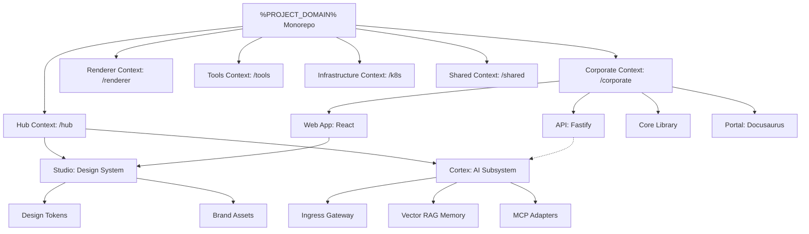

# Bounded Contexts

We use **PNPM Workspaces** with a **Context-Driven Root** layout to strictly isolate our business domains. This architecture ensures scalability and clear separation of concerns by organizing the codebase into distinct Bounded Contexts at the root.

---

## Monorepo Structure & Workspace Roles

The monorepo distinguishes between different core contexts. The following diagram illustrates the workspace contexts, package relationships, and dependency flow:

| Directory                   | Package Name                           | Role            | Responsibility                                                           |
| :-------------------------- | :------------------------------------- | :-------------- | :----------------------------------------------------------------------- |
| `corporate/services/web`    | `@tupynambalucas-dev/corporate-web`    | **Application** | Corporate public web portal and customer-facing interface.               |
| `corporate/services/api`    | `@tupynambalucas-dev/corporate-api`    | **Application** | Enterprise Fastify REST API serving business logic and data models.      |
| `corporate/packages/core`   | `@tupynambalucas-dev/corporate-core`   | **Library**     | SSOT domain schemas and Zod validators for corporate applications.       |
| `corporate/services/portal` | `@tupynambalucas-dev/corporate-portal` | **Docs Hub**    | Authoritative Docusaurus developer portal and knowledge hub.             |
| `hub/cortex/`               | `@tupynambalucas-dev/cortex-*`         | **Tooling**     | Unified AI gateway, MCP adapters, and vector memory.                     |
| `hub/studio/assets`         | `@tupynambalucas-dev/studio-assets`    | **Library**     | Design tokens, logos, SVGs, and brand styling assets.                    |
| `hub/studio/bucket`         | `@tupynambalucas-dev/studio-bucket`    | **Tooling**     | Bidirectional Cloudflare R2 object storage CLI synchronizer.             |
| `renderer/`                 | `@tupynambalucas-dev/renderer`         | **Application** | Dynamic asset generator and document compilation engine.                 |
| `tools/`                    | `@tupynambalucas-dev/tools-*`          | **Tooling**     | Development utilities and GitHub CLI automation scripts.                 |
| `shared/`                   | `@tupynambalucas-dev/shared-*`         | **Library**     | Cross-workspace shared configurations, project constants, and git hooks. |

---

## Bounded Context Philosophy

- **Context Isolation**: Each root directory (`corporate/`, `hub/`, `renderer/`, `tools/`, `k8s/`, `shared/`) represents an isolated workspace context. Types, contracts, and configurations are encapsulated locally, referencing external libraries only through package boundaries.
- **Strict Decoupling**: Business logic from the Corporate Context (`corporate/`) is decoupled from the Profile Stats Compiler (`renderer/`) and the internal Hub (`hub/`).

---

## Detailed Context Breakdown

### Hub Context (`hub/`)

Manages personal portfolio frontend pages, blog operations, contact form persistence, and administrator options. For detailed documentation, see the **[Hub Workspace](/workspaces/hub)**.

### Cortex Context (`cortex/`)

The consolidated AI Bounded Context. Integrates the API gateway proxy, persistent memory indexes, downstream MCP adapters, and sandboxed AI developer terminal sessions. For detailed documentation, see the **[Cortex Workspace](/workspaces/cortex)**.

### Renderer Context (`renderer/`)

An extensible Dynamic Asset Generator and Document Compilation Engine built with TypeScript to compile markdown templates and render SVG charts. For detailed documentation, see the **[Renderer Workspace](/workspaces/renderer)**.

### Studio Context (`studio/`)

The single source of truth for visual identity, icons, and shared CSS variables. For detailed documentation, see the **[Studio Workspace](/workspaces/studio)**.

### Tools Context (`tools/`)

The developer automation workspace, isolating command-line tools like Git Flow and GitHub CLI. For detailed documentation, see the **[Tools Workspace](/workspaces/tools)**.

### Platform Context (`platform/`)

Orchestrates OpenTelemetry pipelines and remote caching to accelerate developer builds. For detailed documentation, see the **[Platform Workspace](/workspaces/platform)**.

### Knowledge Base Context (`knowledge-base/`)

The developer documentation hub. For detailed documentation, see the **[Knowledge Base Workspace](/workspaces/knowledge-base)**.
