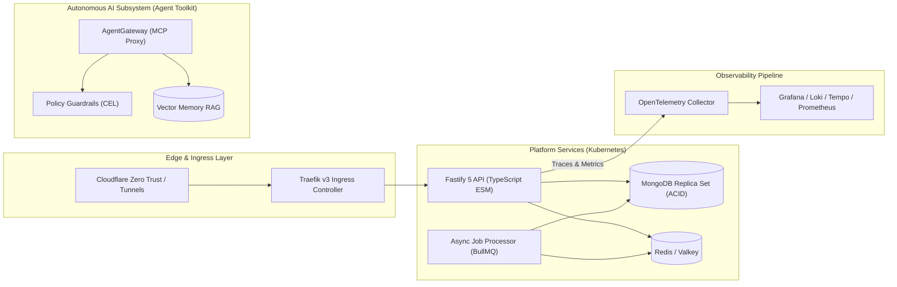

<p align="center">
  {{ headerImage }}
</p>

# Tupynambá Lucas

**Principal Platform & AI Systems Architect / Founding Systems Architect** with deep experience designing and operating sovereign meta-repository ecosystems, high-throughput cloud-native Kubernetes platforms, autonomous AI agent substrates, low-level real-time engines, and cryptographic zero-trust architectures.

---

### Core Architectural Competencies

```
                    ┌──────────────────────────────────────────────┐
                    │          Systems & Meta Architecture         │
                    │   Domain-Driven Design • Git Submodules • SSOT   │
                    └──────────────────────┬───────────────────────┘
                                           │
         ┌─────────────────────────────────┼─────────────────────────────────┐
         ▼                                 ▼                                 ▼
┌──────────────────────────────┐ ┌──────────────────────────────┐ ┌──────────────────────────────┐
│    Cloud-Native & GitOps     │ │    Autonomous AI Platform    │ │   Real-Time Systems & Wasm   │
│ Kubernetes • Helm • ArgoCD   │ │ Model Context Protocol (MCP) │ │   Tessel Engine • WebGL/GPU  │
│  Traefik v3 • OpenTelemetry  │ │ Policy Guardrails • Memory   │ │ High Performance Runtimes   │
└──────────────────────────────┘ └──────────────────────────────┘ └──────────────────────────────┘
```

- **Meta-Repository & Multi-Repo Orchestration**: Master umbrella architecture (`org-core`) orchestrating federated repositories via Git Submodules (`platform`, `agent-toolkit`, `docs`, `.github`), enforced with 5-pillar automated workstation convergence, automated verification scripts, and deterministic submodule pointer synchronizations.
- **Cloud-Native Infrastructure & GitOps**: Multi-cluster local and cloud Kubernetes orchestration (`k3d`, Skaffold, Helm, Kustomize), continuous GitOps deployments via ArgoCD, Cloudflare Zero Trust tunnels and edge routing, Traefik v3 ingress controllers, and automated ACME TLS certificate lifecycle management.
- **Autonomous AI Substrate & Agentic Infrastructure**: Self-hosted Model Context Protocol (MCP) gateways, policy-enforced guardrails using Common Expression Language (CEL), vector RAG layers, and enterprise autonomous agent customization frameworks (Antigravity).
- **Distributed Backends & Data Integrity**: Event-driven and transactional microservices with Node.js 22+ (strict ESM) and Fastify 5, asynchronous job queuing and state caching with Redis/Valkey (BullMQ), and multi-document ACID transactions with MongoDB replica sets and PostgreSQL.
- **Full-Stack LGTM Observability**: Comprehensive OpenTelemetry Collector pipelines exporting Prometheus metrics, Grafana Loki logs, and Grafana Tempo distributed traces with Pyroscope continuous profiling.
- **Sovereign Documentation Architecture**: Enterprise knowledge hubs (`docs`) structured strictly under the Diátaxis framework (Tutorials, How-To Guides, Technical Reference, Explanations) built with Docusaurus v3 and Crowdin localization.

---

### Engineering Foundations Matrix

| Domain                       | Standards & Implementations                                                               |
| :--------------------------- | :---------------------------------------------------------------------------------------- |
| **Architectural Patterns**   | Domain-Driven Design (DDD), Hexagonal Architecture, Ports & Adapters, GitOps Reconcilers. |
| **Languages & Runtimes**     | TypeScript (strict mode, zero-any), Node.js 22+ (ESM), Go, Rust/Wasm, PowerShell, Bash.   |
| **API & Agentic Protocols**  | Model Context Protocol (MCP), REST, Fastify 5, WebSockets, Server-Sent Events, OpenAPI 3. |
| **Storage & Data Integrity** | MongoDB (Replica Sets, ACID transactions, Vector Search), PostgreSQL, Redis, Valkey.      |
| **Platform & Networking**    | Kubernetes, Skaffold, Helm, Kustomize, Traefik v3, Cloudflare Zero Trust, Docker.         |
| **Observability & SRE**      | OpenTelemetry Collector, Prometheus, Grafana, Loki, Tempo, Pyroscope (LGTM Stack).        |
| **Security & Governance**    | SSH Cryptographic Signatures (`git commit -S`), Infisical Universal Auth, Zero-Emoji.     |

---

### Platform & AI Subsystem Topology

Representative architecture of distributed platforms and autonomous systems engineered across the ecosystem:



---

### Dynamic Engineering Metrics

<p align="center">
  {{ overviewImages }}&nbsp;&nbsp;{{ languagesImages }}
</p>

---

### Key Technical Principles

1. **Deterministic & Strict Typing**: Elimination of implicit any, schema validation at all system boundaries (Zod), and end-to-end compile-time type safety.
2. **GitOps & Single Source of Truth (SSOT)**: All cluster infrastructure, services, and agent configurations are declared declaratively and reconciled through GitOps pipelines.
3. **Defense in Depth & Cryptographic Invariants**: Zero hardcoded credentials, centralized secrets via Infisical Universal Auth, SSH cryptographic commit signing (`git commit -S`), and network boundary isolation.
4. **Autonomous AI as Infrastructure**: Agentic systems engineered with strict contracts, deterministic evaluation, audit trails, and policy guardrails.
5. **Architectural Pragmatism**: Matching data models and protocols to workload realities rather than industry trends.
