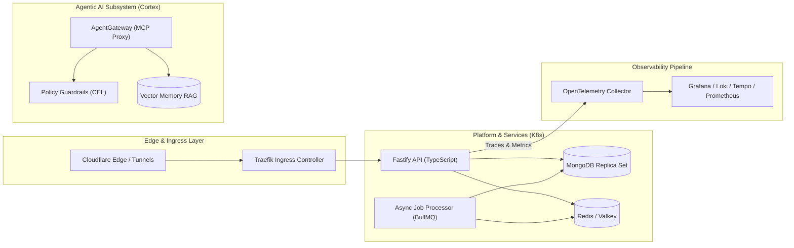

# Tupynambá Lucas

**Software Engineer & Systems Architect** with over a decade of hands-on experience designing end-to-end distributed systems, domain-driven architectures, and autonomous AI-driven platforms.

---

### Core Architectural Competencies

```
                  ┌─────────────────────────────────────────┐
                  │          Systems Architecture           │
                  │   DDD • Bounded Contexts • Hexagonal    │
                  └────────────────────┬────────────────────┘
                                       │
        ┌──────────────────────────────┴──────────────────────────────┐
        ▼                                                             ▼
┌───────────────────────────────┐             ┌───────────────────────────────┐
│     Cloud Native & GitOps     │             │     AI-Driven Engineering     │
│  Kubernetes • ArgoCD • Docker │             │    Model Context Protocol     │
│   Traefik • OpenTelemetry     │             │ AgentGateway • Memory Subsys  │
└───────────────────────────────┘             └───────────────────────────────┘
```

- **Domain Modeling & System Boundaries**: Deep implementation of Domain-Driven Design (DDD), formal Bounded Context isolation, Single Source of Truth (SSOT), and modular monorepos managed with PNPM Workspaces and Turborepo.
- **Backend & Distributed Systems**: Event-driven and transactional systems with Node.js/TypeScript and Fastify, Redis/Valkey for asynchronous job queuing (BullMQ), and multi-document ACID transactions with MongoDB replica sets.
- **Cloud-Native Infrastructure & GitOps**: Multi-cluster local and cloud Kubernetes orchestration (k3d, Skaffold, Helm), automated GitOps deployments via ArgoCD, Cloudflare edge networks (Tunnels, Pages, Workers), and cert-manager ACME automation.
- **Full-Stack Observability**: Production observability pipelines using OpenTelemetry Collector exporting metrics to Prometheus, logs to Grafana Loki, and distributed traces to Grafana Tempo (LGTM stack).
- **AI-Driven & Agentic Tooling**: Self-hosted Model Context Protocol (MCP) gateways, policy-enforced guardrails (CEL), vector RAG layers, and custom autonomous agent customization frameworks (Antigravity).

---

### Engineering Foundations

| Domain                       | Standard & Implementations                                                                |
| :--------------------------- | :---------------------------------------------------------------------------------------- |
| **Architectural Patterns**   | Domain-Driven Design (DDD), Hexagonal Architecture, Ports & Adapters, Event-Driven.       |
| **Language & Runtimes**      | TypeScript (strict mode), Node.js (ESM), Go, Bash/PowerShell automation.                  |
| **API & Protocols**          | REST, Fastify 5, WebSockets, Model Context Protocol (MCP), SSE, OpenAPI/JSON Schema.      |
| **Storage & Data Integrity** | MongoDB (Replica Sets, ACID transactions, Vector Search), PostgreSQL, Redis, Valkey.      |
| **Platform & Networking**    | Kubernetes, Skaffold, Helm, Traefik v3, Cloudflare Zero Trust, Docker.                    |
| **Observability & SRE**      | OpenTelemetry, Prometheus, Grafana, Loki, Tempo, Pyroscope.                               |
| **Quality & Security**       | Deterministic builds, Infisical Secret Governance, Conventional Commits, Prettier/ESLint. |

---

### Platform Architecture Blueprint

Representative topology of distributed platforms and autonomous systems I engineer:



---

### Dynamic Engineering Metrics

<p align="center">
  {{ overviewImages }}&nbsp;&nbsp;{{ languagesImages }}
</p>

---

### Key Technical Principles

1. **Deterministic & Strict Typing**: Elimination of implicit any, schema validation at all system boundaries (Zod), and end-to-end compile-time safety.
2. **Architecture Driven by Requirements, Not Hype**: Pragmatic database and protocol selection matching workload demands (e.g., MongoDB replica sets for document models, Redis for state, PostgreSQL for relations).
3. **Defense in Depth**: Zero hardcoded credentials, centralized secrets via Infisical Universal Auth, network isolation, and branch protection rulesets.
4. **Autonomous AI as Infrastructure**: Agentic AI treated as first-class infrastructure with strict contracts, audit logs, and deterministic verification.
